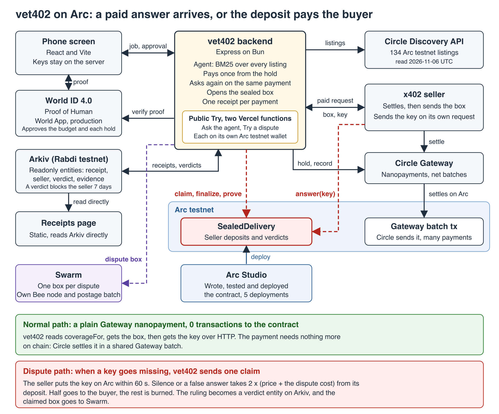

# vet402 on Arc

With Arc, vet402 gives every answer an AI agent pays for one of two endings: it arrives, or the seller's deposit pays the buyer back. The payment stays a plain Circle Gateway nanopayment, and SealedDelivery on Arc steps in only when a key goes missing, with the seller's deposit on Arc behind the sealed answer. World ID puts a person's approval on the moment money reaches the agent. Arkiv keeps every receipt and every ruling of Arc where anyone can read them, so the next purchase from a seller Arc ruled against stops before any money moves. Swarm holds each disputed box, on a postage batch my own Bee node bought.

Anyone can try a real dispute on Arc and a real purchase from a seller in Circle's catalog at https://vet402-mumbai-live.vercel.app, and the same contract runs on Arc mainnet. One payment, one receipt, and the chain only when a delivery needs it.

## The problem, and how vet402 solves it on Arc

An agent that pays for an API today has no recourse when the answer never comes. On 2026-09-28, one Arc mainnet transaction settled 50 purchases by vet402, an AI agent I already own: 31 delivered, and 19 were charged and returned nothing it could use. A retry with a new signature pays again, as Seller B showed at the event: Circle's record shows 2 transfers, `e9cbd6d5-d3a3-4693-9e6d-f9d33a197b31` and `b9d962ef-6276-4f29-a94d-87618539a6fd`, 2026-11-05 16:04 UTC. [circlefin/arc-nanopayments#43](https://github.com/circlefin/arc-nanopayments/issues/43) describes the same problem (open on 2026-11-05 UTC).

vet402 solves it on Arc. The answer arrives locked, and the key comes on a separate request. When the key goes missing, vet402 sends one claim to SealedDelivery, and the seller has 60 seconds to put the key on chain. An answer repays the buyer the gas of its claim from the seller's deposit, in the same transaction. Silence or a swapped answer costs the deposit twice the price plus the buyer's gas for the whole dispute, counted at the gas price the claim paid: half to the buyer, the rest burned, so a seller that pays itself through a second address loses half. The buyer comes out whole whenever the claim's gas price is at most 100 gwei, its later calls use the claim's gas price, and the deposit covers the verdict, which vet402 checks with `coverageFor` before it pays.

vet402's sellers answer a claim through Arc's Memo contract at their own cost, so the answer transaction on the explorer names the Circle Gateway transfer, the Swarm reference of the box, and the claim id the Arkiv evidence entity carries. Once 0.05 USDC of refunds has come back, vet402 puts it into the agent's Gateway balance in one Circle Gateway `depositFor`, ready for the next payment.

Proof on Arc testnet, 2026-11-06 01:59 to 02:04 UTC, on the final contract, each at a price of 0.001 USDC. Sellers A, D, E and F are demo sellers, each built to take one path: answer, stay silent, send a wrong key, or swap the answer, so every outcome of the contract is on Arc to check. Each deposited 0.5 USDC at 01:37 UTC. The "line stayed up" row is from the run of 01:42 UTC on the same contract. All rows, the run of 01:42 to 01:46 UTC, and the runs on earlier versions are in [DEMO.md](DEMO.md).

| Seller | What it did | Result | Onchain proof |
|---|---|---|---|
| A | Line stayed up | "Charged once. Delivered." 2.1 s from the start, 01:42 UTC | Transfer `8df8ff6d-df86-4aa1-b9fb-840347074510`, 0 transactions to the contract |
| A | Dropped the key request, answered the claim | "Charged once. Key read from Arc." "Claim gas repaid by the seller: 0.006949 USDC." "Circle record: 1 transfer for this payment." Key on chain 7.2 s from the start | Claim [`0x6fbe43cb…`](https://explorer.testnet.arc.io/tx/0x6fbe43cb52a151c51b4b01736bcc99f94bc9f98b249c42de09acf54c1af0d5da), answer [`0x7e816df8…`](https://explorer.testnet.arc.io/tx/0x7e816df8f4631d9b0172c9a3da16f820f56dc4360f0657816d9914bc29f3fc11) |
| E | Said nothing | "The seller stayed silent. Its deposit paid 0.011413 USDC back: the 0.001 USDC price and 0.010413 USDC for the gas of the dispute." | Claim [`0xf1ba70bd…`](https://explorer.testnet.arc.io/tx/0xf1ba70bd45d40f05cccaae9fbf8e3d39b6f027375f3cf28ed5b9b2fa89aa681f), finalize [`0x924ad0c9…`](https://explorer.testnet.arc.io/tx/0x924ad0c91688abcb24c83d9c99efd72e365102f2b626fc0045f39166c716a9ed) |
| D | Tried a wrong key, then said nothing | "Wrong key rejected by the contract." "The seller stayed silent. Its deposit paid 0.012142 USDC back: the 0.001 USDC price and 0.011142 USDC for the gas of the dispute." | Claim [`0x67698fff…`](https://explorer.testnet.arc.io/tx/0x67698fff825e33a5246cbd352e0e22287a39c4f01138e14112dee3842efc066d), reverted answer [`0x95b35393…`](https://explorer.testnet.arc.io/tx/0x95b353935b893116dd398828157e1ef7676a368e4428284acd1abc9361d72aa1), finalize [`0x9baef1dd…`](https://explorer.testnet.arc.io/tx/0x9baef1dd448e64221aa186f77a46e3d8ed720e245aabcf42f60e2502d02baa98) |
| F | Swapped the answer, then gave its key | "Claim gas repaid by the seller: 0.006949 USDC." "The answer did not match the seller's promise. Its deposit paid 0.013699 USDC back: the 0.001 USDC price and 0.012699 USDC for the gas of the dispute." | Claim [`0x0bd9b723…`](https://explorer.testnet.arc.io/tx/0x0bd9b7234d1c29973260969109a2827ef35b0d45be73fd9efb570f285361f48f), answer [`0x5a5e0606…`](https://explorer.testnet.arc.io/tx/0x5a5e06064433ab10ea339b76f5a8c3da64b6fdd37c97175182a67b173a1a74d0), prove [`0xccfb2bd7…`](https://explorer.testnet.arc.io/tx/0xccfb2bd733da6f8a0980a8a6a2a80f04706a792ba78b973a1cc8d6c7d819df12) |

The same contract runs on Arc mainnet at [`0xf3e2a77e…`](https://explorer.arc.io/address/0xf3e2a77e1a93eeb791ae1016f411e5bb8a05e6d9). On 2026-11-06 between 02:02 and 02:04 UTC, a demo seller there answered one claim and stayed silent on a second. The buyer ended 0.000139 USDC and 0.001355 USDC ahead, after its own gas. [Contract](#contract) has the transactions.

## Why this matters

x402 is turning into the common way software pays for software. The Linux Foundation launched the x402 Foundation on 2026-07-14 with 40 members, and Visa, Mastercard, Google, AWS, Stripe, Cloudflare, Circle and Coinbase are among its premier members ([announcement](https://www.linuxfoundation.org/press/linux-foundation-announces-operational-launch-of-x402-foundation-to-standardize-internet-native-payments-for-ai-agents-and-applications)). Chainalysis counted more than 100 million x402 payments on Base through the first quarter of 2026 ([Chainalysis, 2026-06-03](https://www.chainalysis.com/blog/x402-agentic-payments-adoption/)). Cloudflare's Monetization Gateway post lists "zero chargebacks" ([Cloudflare, 2026-07-01](https://blog.cloudflare.com/monetization-gateway/)). A buyer whose answer never came has nowhere to go. A CoinDesk column of 2026-10-28 puts it in one line: "Payment finality is not commercial finality" ([CoinDesk](https://www.coindesk.com/coindesk-indices/2026/10/28/crypto-long-and-short-what-happens-when-an-ai-agent-pays-for-the-wrong-thing)).

Other fixes put every payment through an escrow or a job contract. vet402 leaves a normal payment as it is and touches the chain only in a dispute.

| | [x402r](https://docs.x402r.org) | [authCapture](https://github.com/x402-foundation/x402/pull/1425) | [x402B](https://github.com/bosonprotocol/x402b) | [ERC-8183](https://eips.ethereum.org/EIPS/eip-8183) | vet402 |
|---|---|---|---|---|---|
| Escrow or job contract calls on a payment with no dispute | 1 or more. The buyer pays into escrow and the merchant captures | 1 or more. Authorize then capture on `AuthCaptureEscrow`, or one call when it captures at once | 1 or more. The money goes into Boson's escrow at commit | 4: `createJob`, `fund`, `submit`, `complete` | 0 to SealedDelivery, measured with Seller A on 2026-11-06 at 01:42 UTC ([Architecture](#architecture)) |
| Buyer signatures per payment | Not stated in the docs | 1, an ERC-3009 or Permit2 signature | 2 or more, a meta transaction and a token authorization | 2 or more transactions, `createJob` and `fund` | 1, the EIP-3009 signature x402 already asks for |
| Works with Circle Gateway batched payments | Not stated. The docs list Base and Base Sepolia | Not stated | Not stated | Not stated | Yes. The contract checks the buyer's `GatewayWalletBatched` signature, and every payment of the [run of 01:42 UTC on the live contract](DEMO.md#the-run-of-0142-to-0146-utc) settled in a Gateway batch |
| What a seller adds | Not measured | Not measured | Not measured | Not measured | One middleware and its route, 2 lines in the [package README](packages/sealed-delivery/README.md) that `test/readme.test.ts` runs. The package source is 692 lines |

ERC-8183 also says it has "No dispute resolution or arbitration". In a dispute vet402 sends one claim, and a seller that stays silent or lies pays the buyer from its deposit.

## Architecture



Vector version: [docs/architecture.svg](docs/architecture.svg).

A payment that goes normally sends no transaction to SealedDelivery. Measured on Arc testnet, 2026-11-06 01:42 UTC: Seller A with the line up, delivered 2.1 s from the start, and no claim for that payment among the contract's 12 `Claimed` events, read at 02:10 UTC. Circle still settles the payment in a Gateway batch that Circle sends, and one batch carries many payments. A seller's deposit takes one transaction up front.

Before paying, vet402 reads `coverageFor(seller, price)`, so every claim it sends is backed by the seller's deposit. A seller below that cover is paid like Seller B: once, with no second charge. A box lost on the way comes back on a second fetch with the same payment, for a seller that declares it.

## The agent picks the seller

Ask the agent at the top of https://vet402-mumbai-live.vercel.app, from a phone. vet402 reads Circle's Discovery catalog for Arc testnet, 134 listings on 2026-11-06 (132 Quicknode JSON-RPC nodes and 2 BotPay listings), and scores every listing against the words of the job with BM25. It runs without a language model, and every seller and path comes from the catalog.

- A job about a payment goes to a JSON-RPC node on the network vet402 pays on. vet402 knows a node by the request its listing asks for, and finds Arc Testnet by name in the listing. It then asks for the receipt of its own latest batch, once.
- Any other job goes to the listing whose own words fit best, if vet402 can fill in the request that listing needs.
- vet402 moves on to the next listing for one over the 0.01 USDC limit, a seller Arkiv shows with no recent delivery, or a sealing seller whose deposit is below the cover for the price.

Beside the catalog the agent ranks **vet402 Payment Check**, vet402's own seller (`server/paymentCheckSeller.ts`). It reads Circle's record of the agent's last payment and sends the answer sealed on Arc, under SealedDelivery. When `coverageFor` confirms its deposit covers the price, the approval card adds "Protected on Arc: if the answer goes missing, the seller's deposit pays you back." The agent opens the sealed answer with its key and checks it against the hashes the seller signed, and when the key goes missing it files the claim on Arc itself. On 2026-11-06 at 04:59 UTC the phone layout approved it, and the answer arrived 1.3 s later, checked against the hashes the seller signed. The receipt reads "Answer received and checked. You paid 0.001 USDC once." **vet402 Balance Check** (`server/balanceCheckSeller.ts`) answers "How much USDC does my agent have?" from Circle Gateway's balance, protected the same way. The person sets the agent's limit on the phone ("Spend up to 0.001, 0.005 or 0.01 USDC per job"). The server enforces it and the signed plan carries it, so a job above it reads "Over your limit of 0.001 USDC. Nothing was paid." "What your agent bought" lists each purchase in that browser. "Try it with the line dropped" runs the protected path for real: the key is not handed over, the agent claims on SealedDelivery, the seller answers through Arc Memo, and the phone reads "The line dropped. vet402 asked Arc, the seller answered there, and you got your answer. Charged once." (2026-11-06 07:28 UTC, 4.1 s after the tap).

Before it pays, the card shows the pick, one line on why, and the top 3 it compared, then asks "May I spend up to 0.0001 USDC on this job?" Nothing moves until Approve. The receipt reads "Paid 0.0001 USDC. Settled on Arc." with a link to the batch on the Arc explorer.

| Job | Pick | Price |
|---|---|---|
| Did my last payment go through? | vet402 Payment Check, protected on Arc. Quicknode's Arc Testnet node is second, and the pick when the deposit does not cover it | 0.001 USDC |
| Get me a paid access receipt | BotPay, `/pay` | 0.01 USDC |
| How much USDC does my agent have? | vet402 Balance Check, protected on Arc | 0.001 USDC |
| What's the weather in Mumbai? | Nobody. "None of the 134 Arc listings matched. Nothing was paid." | 0 |

The public agent pays from its own Arc testnet wallet, `TRY_JOB_HOLD_KEY`, never the dispute wallet. The browser sends only the words of the job and, to approve, the signed id of the plan. The server plans again from the same words and pays only the same seller at the same price. One paid job every 2 minutes per address, and 40 a day across every instance (`TRY_JOB_DAILY_LIMIT`). Without the key the card says the agent is resting. The tests run on a saved copy of the catalog: `server/__tests__/agentPick.test.ts` and `server/__tests__/tryJob.test.ts`.

## Contract

| | |
|---|---|
| Contract | `SealedDelivery`, source in [contracts/SealedDelivery.sol](contracts/SealedDelivery.sol), mechanism and how to use it in [contracts/README.md](contracts/README.md) |
| Address | [`0xE9C35ad2caF5D76CA5a5F61ca2256995197C2A4B`](https://explorer.testnet.arc.io/address/0xE9C35ad2caF5D76CA5a5F61ca2256995197C2A4B) |
| Network | Arc testnet, chain id 5042002 |
| Deploy transaction | [`0x38095fb7894b86e2c57be1d1bb6e367ddbc6fd9fc9276ecacc43ac37701b3733`](https://explorer.testnet.arc.io/tx/0x38095fb7894b86e2c57be1d1bb6e367ddbc6fd9fc9276ecacc43ac37701b3733), 2026-11-06 01:35:22 UTC. Sent with `forge create` from the terminal of the Arc Studio sandbox, by `0xBdccB9ef5aBf024A513566dB8d45DE0315e0735f`, a key used only on testnet |
| Arguments | `maxExpiry` 3600 s, `answerWindow` 60 s, `cooldown` 7200 s, USDC `0x3600000000000000000000000000000000000000`, payment domain `GatewayWalletBatched` version `1` at `0x0077777d7EBA4688BDeF3E311b846F25870A19B9` with a zero `paymentDomainSalt`, `followUpGas` 230000, `maxGasPrice` 100 gwei. `MAX_DISPUTE_COST` reads 55000 (0.055 USDC) |
| Source | Verified on the Arc testnet explorer (Blockscout) at 2026-11-06 01:50 UTC, solc 0.8.28, optimizer on, EVM `cancun`. The verified file has the same sha256 as `contracts/SealedDelivery.sol` on `main` (`93a08889…`) |
| Arc mainnet | [`0xf3e2a77e1a93eeb791ae1016f411e5bb8a05e6d9`](https://explorer.arc.io/address/0xf3e2a77e1a93eeb791ae1016f411e5bb8a05e6d9), chain id 5042, the same source and arguments with Arc mainnet's Gateway Wallet `0x77777777Dcc4d5A8B6E418Fd04D8997ef11000eE`. Deployed by script at 2026-11-06 02:02:56 UTC, [`0x6a276f7a…`](https://explorer.arc.io/tx/0x6a276f7a2ca79260ccdfc28a809b889a2febd95d684e9a5db818ecb2581eabd8). Sourcify `exact_match` |
| Earlier versions | On testnet, five deployments by Arc Studio's agent, all from earlier source. The last of them, `0xa1eff55da9f1cee94d608e2570bda89f8f2ce5b5` (2026-11-05 22:20 UTC), charged a fixed `disputeCost` of 0.0105 USDC in place of the gas each claim paid. On mainnet, the earlier version `0xafdb8931eebdce7f714ac3905c65a50293eb6db6` (2026-11-05 21:59 UTC) charged a fixed 0.009 USDC. Their runs are under [Earlier runs](DEMO.md#earlier-runs). The final version replaced them |
| Arc Studio | App id `f6f547d3-78ad-4550-9805-8fc08ac65425`, [workspace](https://studio.arc.io/app/f6f547d3-78ad-4550-9805-8fc08ac65425) |
| Share link | {{SHARE_URL}} |
| Live screen | https://vet402-mumbai-live.vercel.app, whose Try a dispute claims on `0xE9C35ad2…` since 2026-11-06 01:38 UTC |

The two mainnet rounds, all status 1, at 20.001 to 20.00115 gwei:

| UTC | Step | Gas used | Fee in USDC | Transaction |
|---|---|---:|---:|---|
| 02:03:08 | Round 1 `claim` | 271,037 | 0.005421 | [`0x183be3f0…`](https://explorer.arc.io/tx/0x183be3f0fb87c826b6f26f2a4103e5419772843d842c3718f96e284c85e37fa8) |
| 02:03:10 | Round 1 `answer`, `ClaimGasRepaid` 0.00556 USDC to the buyer | 131,604 | 0.002632 | [`0x7541a28b…`](https://explorer.arc.io/tx/0x7541a28bc973fec1969705db7a5e407e48b8ec27c8ff9419732ceb03fd235124) |
| 02:03:13 | Round 2 `claim` | 271,049 | 0.005421 | [`0x9c7229b0…`](https://explorer.arc.io/tx/0x9c7229b0d124973484991ff5cd59858a612ed20d6c1ec4e11cff8d0d9e4c61d0) |
| 02:04:20 | Round 2 `finalize`, `Silent` with 0.01116 USDC for the buyer | 115,874 | 0.002318 | [`0x52162804…`](https://explorer.arc.io/tx/0x521628040a75d008ab4fed04c01f7351ea2035d4c6ed93e5b3fe581b99865555) |
| 02:04:22 | Round 2 `withdrawClaimable` | 53,316 | 0.001066 | [`0x229c82ee…`](https://explorer.arc.io/tx/0x229c82ee7e4c5b14f7c52cea0bc8f3e8bfd31713868ab2236768b38a91fef960) |
| 02:04:24 | `flushBurn`, 0.01116 USDC burned | 57,256 | 0.001145 | [`0x25935b41…`](https://explorer.arc.io/tx/0x25935b4186918c293b415e295b75b6f6d3db4bd27b14f5ab8676265176af8d7c) |

The buyer ended round 1 0.000139 USDC ahead (0.00556 repaid against 0.005421 of claim gas) and round 2 0.001355 USDC ahead (0.01116 credited, less the 0.001 price and its three transactions). Circle's record shows 1 transfer for each payment. The whole mainnet run cost 0.084055 USDC: 0.072895 in gas for twelve transactions, from the deploy to a `requestWithdraw`, and the 0.01116 burned. The seller's remaining 0.11612 USDC can be withdrawn from 2026-11-06 04:04:27 UTC.

## Measured costs

The run of 2026-11-06 01:59 to 02:04 UTC on the testnet contract, and the deposit before it. Every transaction below read status 1 except the one marked reverted, which the contract refused on purpose. The fee is gas used times the gas price each transaction paid, 20.25 to 25 gwei in this run. Arc counts gas in USDC with 18 decimals.

| Call | Gas used | Gas price in gwei | Fee in USDC | Transaction |
|---|---:|---:|---:|---|
| `deposit` | 76,873 | 25 | 0.001922 | [`0x5b33f435…`](https://explorer.testnet.arc.io/tx/0x5b33f435b8c014a645ab9d19513758eea9792995fd053fbbc2493836c26cf3ec) |
| `claim` | 271,013 | 25 | 0.006775 | [`0x6fbe43cb…`](https://explorer.testnet.arc.io/tx/0x6fbe43cb52a151c51b4b01736bcc99f94bc9f98b249c42de09acf54c1af0d5da) |
| `answer` by Seller A, with the refund of the claim gas | 97,015 | 25 | 0.002425 | [`0x7e816df8…`](https://explorer.testnet.arc.io/tx/0x7e816df8f4631d9b0172c9a3da16f820f56dc4360f0657816d9914bc29f3fc11) |
| `answer` with a wrong key, reverted | 29,279 | 21.935 | 0.000642 | [`0x95b35393…`](https://explorer.testnet.arc.io/tx/0x95b353935b893116dd398828157e1ef7676a368e4428284acd1abc9361d72aa1) |
| `finalize` | 98,774 | 20.5 | 0.002025 | [`0x924ad0c9…`](https://explorer.testnet.arc.io/tx/0x924ad0c91688abcb24c83d9c99efd72e365102f2b626fc0045f39166c716a9ed) |
| `prove` on a 70 byte answer | 106,352 | 20.5 | 0.002180 | [`0xccfb2bd7…`](https://explorer.testnet.arc.io/tx/0xccfb2bd733da6f8a0980a8a6a2a80f04706a792ba78b973a1cc8d6c7d819df12) |
| `flushBurn` | 57,256 | 20.5 | 0.001174 | [`0x16884749…`](https://explorer.testnet.arc.io/tx/0x16884749ae92cdc46d60a4c143e140be5ac3ef2874fb35f7047de56c27ee1071) |
| `withdrawClaimable` | 53,316 | 20.5 | 0.001093 | [`0xc7be5f1e…`](https://explorer.testnet.arc.io/tx/0xc7be5f1eb6d04ddb1bf4fe0ce56ddee642bdbe4b618c0ab2d0b3f9a03a5ce76f) |

On this contract, each seller's first `answer` used 131,604 gas and every later one 97,015. The first `finalize` against a seller used 115,862 gas and the next 98,774. The first `prove` used 123,452. [DEMO.md](DEMO.md#contract-transactions) lists all 46 transactions of this contract up to 2026-11-06 02:05 UTC.

The answer pays the buyer back. Claim `0x6fbe43cb…` cost the buyer 0.006775 USDC, and Seller A's answer sent it 0.006949 in the same transaction, so the buyer ended 0.000174 USDC ahead and had its answer.

Deposits read from the contract on 2026-11-06 at 02:17 UTC: Seller A 0.487353 USDC, Seller D 0.448318, Seller E 0.450638, Seller F 0.437452. Each started at 0.5 at 01:37 UTC. Seller A repaid two claims' gas. Sellers D and E each had two SILENT verdicts and Seller F two FRAUD verdicts, one in each run, and Seller F also repaid two claims' gas. The buyer withdrew every credit, and its `claimable` read 0 at 02:17 UTC. A `flushBurn` after each verdict burned the other half.

A claim at the price of 0.001 USDC costs more than the price, so the contract runs only when a delivery fails, and the seller's deposit repays the dispute, under the same three conditions: a claim at 100 gwei or less, later calls at the claim's gas price, and a deposit that still covers the verdict. [contracts/README.md](contracts/README.md#the-economics) has the numbers, and [how vet402 uses it](contracts/README.md#using-it-well) shows how each claim stays inside them.

## How to check this, in order

With nothing installed:

1. Open the [contract](https://explorer.testnet.arc.io/address/0xE9C35ad2caF5D76CA5a5F61ca2256995197C2A4B) on the explorer. Its source is verified there.
2. Open claim [`0x6fbe43cb…`](https://explorer.testnet.arc.io/tx/0x6fbe43cb52a151c51b4b01736bcc99f94bc9f98b249c42de09acf54c1af0d5da) and answer [`0x7e816df8…`](https://explorer.testnet.arc.io/tx/0x7e816df8f4631d9b0172c9a3da16f820f56dc4360f0657816d9914bc29f3fc11). The `KeyRevealed` event holds the key, and `ClaimGasRepaid` sends the buyer 0.006949 USDC.
3. Open reverted answer [`0x95b35393…`](https://explorer.testnet.arc.io/tx/0x95b353935b893116dd398828157e1ef7676a368e4428284acd1abc9361d72aa1). The chain refused a wrong key.
4. Open finalize [`0x924ad0c9…`](https://explorer.testnet.arc.io/tx/0x924ad0c91688abcb24c83d9c99efd72e365102f2b626fc0045f39166c716a9ed). The `Silent` event names Seller E and the 0.011413 USDC credit.
5. Run the Arkiv query further down. It returns the payment entity and the settlement entity for transfer `4c985dc0-a59d-4674-9e8a-3d5d25def02b`, Seller A at 01:42 UTC.
6. Open the box of that payment's claim on Swarm: https://api.gateway.ethswarm.org/bytes/678485f34be28e46bc7791341ea987e149b38b592ff52ad9aecfa6e292696ec8. Its `claimId` is the one in claim [`0x1269e948…`](https://explorer.testnet.arc.io/tx/0x1269e9487f9fbe1207f1791cfdc9963bf9fb20d93854722c9f794f79c597f94b). [arkiv/swarm.md](arkiv/swarm.md#one-entity-and-the-box-it-points-to) shows the Arkiv entity that points to it.
7. Open the [mainnet contract](https://explorer.arc.io/address/0xf3e2a77e1a93eeb791ae1016f411e5bb8a05e6d9) and its answer [`0x7541a28b…`](https://explorer.arc.io/tx/0x7541a28bc973fec1969705db7a5e407e48b8ec27c8ff9419732ceb03fd235124) and finalize [`0x52162804…`](https://explorer.arc.io/tx/0x521628040a75d008ab4fed04c01f7351ea2035d4c6ed93e5b3fe581b99865555).
8. Open the live screen, listed in the contract table. It shows receipts and checks them, and its Ask the agent and Try a dispute cards pay from their own Arc testnet wallets.

With a clone (commands below, results from a fresh clone of commit `4ad89eb` on 2026-11-06 between 02:10 and 02:20 UTC, forge 1.8.3):

9. `forge test`: 236 tests passed in 19 suites on forge 1.8.3. In the Arc Studio sandbox, forge 1.7.1 passed 246 and failed 0 on the same 19 test files before the deploy.
10. `bash scripts/test.sh`: 543 tests passed, 0 failed (2026-11-06 05:33 UTC).
11. `npx bun run scripts/sealed-local-e2e.ts`: every scene ran against the real contract on a local anvil chain, with real signatures and with Gateway replaced by a stand-in. It printed `RESULT: all scenes as expected`.

## Run it

You need Node.js and Foundry.

```bash
git clone https://github.com/kzmttkc/vet402-mumbai.git
cd vet402-mumbai
npx bun@1.3.14 install --frozen-lockfile
forge install foundry-rs/forge-std --no-git
```

Start the backend in one terminal and the screen in another:

```bash
SEALED_DELIVERY_ADDRESS=0xE9C35ad2caF5D76CA5a5F61ca2256995197C2A4B npx bun run server/index.ts
```

```bash
npx vite
```

Open http://localhost:5173. The first backend start writes fresh keys for the buyer, the hold and the sellers to `.env`, which git ignores.

To pay for real on Arc testnet:

1. Print the buyer address with `cast wallet address --private-key <BUYER_PRIVATE_KEY from .env>` and send it testnet USDC from https://faucet.circle.com.
2. Run `SEALED_DELIVERY_ADDRESS=0xE9C35ad2caF5D76CA5a5F61ca2256995197C2A4B npx bun run scripts/sealed-setup.ts --dry-run` to see the plan, then run it again without `--dry-run`. It sends each of Seller A, D, E and F 0.03 USDC for gas and tops each deposit up to 0.5 USDC, so 2.12 USDC in total for fresh sellers. The dry run prints the exact amounts.
3. Open http://localhost:5173/?demo, which shows the scene buttons. Set a hold, then press "Seller A, line stays up", "Try Seller A", "Try Seller B", "Try Seller D", "Try Seller E" or "Try Seller F".

The sellers close the connection on purpose, apart from the "line stays up" button.

| Optional setting | What it turns on |
|---|---|
| `WORLD_APP_ID`, `WORLD_RP_ID`, `WORLD_SIGNER_KEY` | The World ID approval before a hold. Set all three or none |
| `WORLD_ENVIRONMENT` | `staging` (default, the World ID Simulator) or `production` (the real World App, shown as a QR code) |
| `ARKIV_WRITER_KEY`, `ARKIV_ACCESS_KEY` | The Arkiv receipts, and the check of Arc's rulings before each payment, including the demo buttons. Without them the app runs on local receipts alone |
| `SWARM_API_URL`, `SWARM_POSTAGE_BATCH_ID` | Upload each dispute box through your own Bee API, stamped with your own postage batch. Without them the box goes through the public Swarm gateway. `SWARM_UPLOAD=off` keeps boxes off Swarm |
| `PORT`, `DATA_DIR` | The backend port, 3001 by default, and its data folder |

`npx vite build` makes the published screen. Its only paying routes are the two Vercel functions, `api/try-dispute.ts` and `api/try-job.ts`, each on a fixed Arc testnet wallet. With `ARKIV_WRITER_ADDRESS` (or `ARKIV_WRITER_KEY`) on the deploy, `api/try-job` reads Arkiv before it picks, with no key. With `ARKIV_WRITER_KEY`, `api/try-dispute` also writes its receipt and evidence entities to Arkiv and puts the claimed box on Swarm through the public gateway. Without it, the try writes nothing.

## Boundary

Pre-event work ends at tag `mumbai-pre-event-2026` in the older repository. This repository starts after it, and the last two lines of this section name the two parts that came from outside the event.

Pre-event, before 2026-11-05 15:30 UTC:

- Product: vet402. ERC-8004 agentId 9907. Registry `eip155:42220:0x8004A169FB4a3325136EB29fA0ceB6D2e539a432`.
- Repo: https://github.com/kzmttkc/vet402
- Tag: `mumbai-pre-event-2026`, an annotated tag. Tag object `cc14616dac3b7256ecfdda731ce1225e71756174`.
- Commit the tag points at: `343cd0c348bdbb12db61a09e1ca04b621d7fd68e`, committed 2026-11-03 17:27 UTC.
- Public receipt page: https://kzmttkc.github.io/arc-delivery-receipts/
- The 2026-09-28 batch in the first paragraph: `0x3a78bad401267d8f0914878db7b15e81a27b44637330f619eefef863209d6616` on Arc mainnet (`eip155:5042`). The 50 transfers and their sellers come from Circle's Gateway API, read on 2026-11-05. The 31 and the 19 come from [round 2 of the receipt page](https://kzmttkc.github.io/arc-delivery-receipts/rounds/2/records.json), matched to those transfers by nonce.

Built at ETHGlobal Mumbai:

- This repo: https://github.com/kzmttkc/vet402-mumbai
- First event commit: `4c452189d8a3943a46c5257d8bd1da448585f066` at 2026-11-05 15:30 UTC.
- Arc Studio app id: `f6f547d3-78ad-4550-9805-8fc08ac65425`.
- World ID: the World ID code in this repo is from the event, starting with `6262f7b` (2026-11-05 16:20 UTC). The staging tries of 2026-10-28 in docs/world-feedback.md were a first look at the Simulator, outside this repo.
- Arkiv: everything Arkiv is from the event. The SDK came in at `cc37eb7` (2026-11-05 16:17 UTC), the first Arkiv writer at `7df3fb3` (16:21 UTC), and all Arkiv code and `arkiv/` were written here.
- Brought in from before the event: `src/existing/arc-gateway.ts`, copied from the tag. Its first line says so.
- Generated by Arc Studio at commit `a6e3fa2`: the starter app. Commit `341edd6` removed the template parts this project leaves out.

## Receipts on Arkiv

vet402 keeps each receipt on Arkiv's Rabdi testnet, so a receipt stays readable when this app is down. The receipts page reads Arkiv directly from the browser, every page of it. Its "Check a seller" box lets anyone paste a payTo address and read Arc's rulings against it from Arkiv, the same check vet402 runs before it pays.

Arkiv is also where a seller's standing lives. Each Silent or Fraud ruling from the contract becomes a readonly `vet402_verdict` entity. Before paying, vet402 reads Arkiv and pays a seller only when Arkiv answers, the seller's record is current, and no ruling from the last 7 days stands against it. Rulings are read by the address that would be paid: for a catalog listing the payTo it names, for my own Sellers A to F the address they are paid at. So after Arc's Fraud ruling on Seller F, **Try Seller F** answers "Seller F: Arc ruled against this seller in the last 7 days. Not paid." and pays nothing. The public agent (`api/try-job`) runs the same check, read only. Only an answer that kept the seller's promise extends the seller's record. Another x402 buyer can ask the same question with `isRuledAgainst(payTo, { writer })` from `packages/sealed-delivery`.

A dispute reaches Arkiv as one fact. Its payment, seller and evidence entities go out in one `executeBatch` transaction, so all three land or none does, and the receipt's Details reads "Arkiv: 1 transaction, 3 entities". In the same transaction the evidence entity passes to the buyer on the claim, the hold that paid and filed it. The entity keeps `readonly` and its creator, so the buyer owns the record of its box, vet402 is still the one that wrote it, and every reader finds it with `createdBy(writer)`. Rulings stay with vet402. Details in [arkiv/how-you-use-arkiv.md](arkiv/how-you-use-arkiv.md#one-transaction-per-dispute).

Swarm holds each disputed box. A box my own Bee node uploads is pinned there, and its evidence entity carries the date its postage batch keeps it until, so "Open a sealed answer" shows "Kept on Swarm until {date}" under it. `scripts/swarm-publish.ts` puts the receipts page itself on Swarm as one collection behind a feed manifest, one bzz URL that always opens the newest page: https://api.gateway.ethswarm.org/bzz/bffd1e6065a6b595d7540e202aac6d7bed3da69ba9abae3530af2eafafec6dd9/ (2026-11-06 04:34 UTC). Details in [arkiv/swarm.md](arkiv/swarm.md).

Writer address: `0x4eeA8EdDCC608CBD8b3683F738a473923F2De4C5`

Print it with `npx bun run scripts/arkiv-address.ts`. The script derives the address from `ARKIV_WRITER_KEY` and never prints the key.

One query you can run. It returns the payment entity and the settlement entity for transfer `4c985dc0-a59d-4674-9e8a-3d5d25def02b`, Seller A at 01:42 UTC on 2026-11-06, the one in step 5 of "How to check this". Receipts live 30 days, so this one expires around 2026-12-06 unless somebody extends it. After that, put a transfer id from the receipts page in place of the id.

```bash
curl -sL https://rpc.rabdi.db-chain.testnet.arkiv.network \
  -H 'content-type: application/json' \
  -d '{"jsonrpc":"2.0","id":1,"method":"arkiv_query","params":["arkiv.schema = str('"'"'vet402_receipt'"'"') AND gateway_transfer_id = str('"'"'4c985dc0-a59d-4674-9e8a-3d5d25def02b'"'"') AND $owner = addr(0x4eeA8EdDCC608CBD8b3683F738a473923F2De4C5)",{"select":{"key":true,"expiresAt":true,"attributes":true}}]}'
```

Arc's rulings, the entities the check reads before paying. At 03:15 UTC on 2026-11-06 it returned 6: 2 Fraud against Seller F and 2 Silent each against Seller D and Seller E, all from the live contract on chain 5042002. Add `AND seller = str('<payTo, lowercase>')` for one seller.

```bash
curl -sL https://rpc.rabdi.db-chain.testnet.arkiv.network \
  -H 'content-type: application/json' \
  -d '{"jsonrpc":"2.0","id":1,"method":"arkiv_query","params":["arkiv.schema = str('"'"'vet402_verdict'"'"') AND kind = str('"'"'verdict'"'"') AND $owner = addr(0x4eeA8EdDCC608CBD8b3683F738a473923F2De4C5)",{"select":{"key":true,"createdAt":true,"attributes":true}}]}'
```

Explorer: https://rabdi.explorer.arkiv.network

More in [arkiv/](arkiv/schema.md).

## World ID

The moment that needs a person is money reaching the agent. vet402 pays with my money and its keys sit on my server. With World ID on, an approval in World App is the only way money reaches the hold wallet. A passkey proves a device, and whoever runs the agent's host can enroll another one. A World ID session proof can come only from the same verified human who set the budget, on any phone, and it carries this hold's amount.

There are two approvals. Both are World ID 4.0 session proofs. Every one asks for Proof of Human, and a hold above 0.5 USDC also asks for a selfie check in the same approval.

1. **Budget.** Setting a budget creates a session. Its proof carries the signal `budget:<amount>:<budget id>`, so the amount saved is the amount I approved on my phone. The backend saves the session id and the proof's session nullifier.
2. **Hold.** Each hold needs a proof of that same session with the signal `<hold id>:<amount>`. The backend accepts it only if the session matches the saved one in full, the signal matches this hold, the session nullifier has never been used, and the hold fits in what the budget has left.

Every hold approved under a budget counts toward it, spent or not. A 1 USDC budget allows a 0.6 USDC hold once and refuses a second one with "Not approved: this is more than the budget has left." A larger hold asks for a new budget, with its own approval. A new budget is a proof of the same session, so only the person who set the first budget can raise it. The backend signs every request and sends every result to World's verify endpoint before anything is saved or held. It also requires the environment, protocol 4.0, exactly the credentials the request asked for and this request's nonce. A hold is the agent's spending limit, so the screen reads "Held 1 USDC for your agent." The jobs the agent plans afterwards are paid from it.

In production (`WORLD_ENVIRONMENT=production`) nothing else adds to the hold. The plain hold route answers 403. The compare scene and the Seller C scene spend from the approved hold, and stop with "The hold doesn’t cover this. Hold more first." when it is too small. Gas sent to the hold wallet for contract calls is taken from the approved budget, and nothing is sent once the budget has no room. Staging keeps the filmed flow, where those two scenes add their own small extra hold.

While a hold waits in production, the screen offers **Replay test**. It sends the previous hold's approval for the new hold, and the screen reads "Not approved: this approval is for another hold." Nothing is held. Every route that starts, approves or cancels a request needs a token the backend makes at start. It hands the token only to a request the browser marks as coming from the app's own page (`Sec-Fetch-Site: same-origin`). Any other POST a browser marks as sent from another site is refused, so no other page can start a demo or approve a job.

**The check grows with the amount.** World ID comes in at one moment: when money enters the agent's hold. vet402 asks for the least that answers the question at that amount.

| Hold | What World App asks for | What it answers |
|---|---|---|
| 0.5 USDC or less | Proof of Human | A unique person, verified at an Orb, approved this hold. The session ties it to the person who set the budget. |
| Above 0.5 USDC | Proof of Human and a selfie check, in one approval | The same, and that person is at the phone right now. World App runs a short camera check against the face from enrollment. |

Everyday small holds stay a quick approval, because Proof of Human already says who approved. A large hold is where a phone left unlocked in someone else's hands would cost the most, so it also asks for the person in front of the camera. vet402 asks for nothing beyond these two. A hold needs no name, age, nationality or passport, so vet402 requests none, and it leaves the selfie check's `sybil_score` unread, because Proof of Human already answers uniqueness. `WORLD_SELFIE_ABOVE` moves the line (default `0.5`).

For a large hold the browser asks IDKit for `proveSession(...).constraints(all(CredentialRequest('proof_of_human', { signal }), CredentialRequest('selfie', { signal })))`, so it is still one QR code and one approval. The backend decided at the start of the request that it needs the selfie check, and it holds only when every proof carries this hold's signal, the result holds exactly `proof_of_human` and `selfie` with issuer 11, both session nullifiers are new, and World's verify answer lists `selfie` with `success: true`. That last check matters because World's verify endpoint answers success when at least one proof passed, so vet402 reads each line. A large hold that comes back without a passing selfie check reads "Not approved: this hold needs a selfie check. Nothing was held." Before the QR code, the card says "This hold is above 0.5 USDC, so World App will also ask for a selfie check."

When World App cannot give the selfie check, IDKit reports `credential_unavailable`, and the World ID Simulator does this on staging. The card then reads "Not approved: this hold needs a selfie check, which World App could not give right now. Nothing was held." The budget keeps its full room, and a hold of 0.5 USDC or less still goes through with Proof of Human alone.

It runs in production with the real World App. On 2026-11-05 at 22:16 UTC I set a budget and approved a hold of 1 USDC with my World App on iOS, verified at an Orb, and the verified result reads environment production, protocol 4.0, proof_of_human. Those runs came before the budget had its own signal. The budget signal, the running total, the production rules for the demo scenes, the session token and the cross site check were added on 2026-11-06, and I ran that version in production the same day: "Budget set." for a 1.2 USDC budget at 02:10 UTC, "Held 1 USDC for your agent." at 02:10 UTC, Replay test refused with "Not approved: this approval is for another hold." at 02:11 UTC and again on film at 02:59 UTC, Cancel request at 02:11 UTC and on film at 02:59 UTC, and a 0.1 USDC hold approved in World App at 02:18 UTC while the iPhone screen was recorded. The budget then had 0.1 USDC left, so the running total held. The selfie check for holds above 0.5 USDC was added after those runs, on 2026-11-06, and the backend tests cover each of its checks. On the selfie version in production, a budget and a 0.5 USDC hold were approved in World App at 05:05 and 05:06 UTC ("Held 0.5 USDC for your agent."). What World App showed for a 1 USDC hold is item 8 of docs/world-feedback.md. The demo video shows the iPhone approval next to the app. The integration debrief is in [DEMO.md](DEMO.md#integration-debrief).

Feedback for the sponsors, each with the step, what came back and the date: [Arc Studio](docs/arc-studio-feedback.md), [World ID](docs/world-feedback.md), [Arkiv](arkiv/friction.md).

## After judging

The buyer side of this goes into vet402's production buyer, which paid through Gateway on Arc mainnet on 2026-09-28. The receipt writer keeps writing one Arkiv entity per payment on Rabdi until Arkiv announces a mainnet.

## How I used AI

I designed the mechanism and made each decision below. Arc Studio and Claude Code wrote the code from my instructions, and every instruction to Arc Studio is in [prompts/](prompts/README.md), with what each turn built.

Arc Studio (session `mumbai`) started the app, and its agent wrote, tested and deployed the first five versions of the contract on testnet. The final testnet contract went through the same Studio sandbox: its source in the code editor, 246 tests passed and 0 failed with forge 1.7.1 in the sandbox terminal, and `forge create` from that terminal on 2026-11-06 at 01:35 UTC. The app's full source, copied into the sandbox, passed `tsc` and 432 tests there. On 2026-11-06 at 02:06 UTC, Studio's Preview ran the published screen from the sandbox, and its Tracing listed the screen's calls to `/api/receipts`, Circle's `/v1/x402/transfers` and Arkiv's `arkiv_query`. Claude Code wrote out my instructions to Arc Studio, pulled its files with `arc-studio pull`, and wrote the rest of the code and these documents.

What I did with my own hands, beside the decisions in the table:

- Set up the World ID app and its signer in World's Developer Portal, and approved budgets and holds in World App on my iPhone in production: 2026-11-05 at 22:16 UTC, and 2026-11-06 at 02:10, 02:18, 05:05 and 05:06 UTC.
- Ran the Arc mainnet disputes and the seller's withdrawal from my own terminal, each after reading the decoded transaction (2026-11-06, 02:03 to 02:04 and 05:02 UTC).
- Funded my Bee node's wallet with xDAI and xBZZ, so the node bought and topped up its own postage batch.
- Recorded every voice line in the demo video.

The table says who wrote each part first, who changed it, and what I decided. Times are 2026-11-05 UTC unless a date is given, with India time (IST) where my design notes give it.

| Part | First written by | Changed by | What I decided |
|---|---|---|---|
| `contracts/SealedDelivery.sol` | Arc Studio, turn sd1 at 16:17. Turns sd2 and sd3 keyed claims by claim id and added the double verdict with a burned half, `coverageFor` and `prove` | Claude Code from 17:24: collateral taken at the verdict, token and payment domain as constructor arguments, `DISPUTE_COST`, the payment domain salt, and on 2026-11-06 the claim's own gas repaid in every outcome (`81d1f32`). Arc Studio's agent built, tested and made the first 5 testnet deployments, in turns sd2 and sd4 to sd7. The sixth and final testnet deployment was a `forge create` from the Studio sandbox terminal on 2026-11-06 at 01:35 UTC, after 246 tests passed there. I deployed both mainnet contracts by script | At 15:00 (20:30 IST): a deposit per seller in place of an escrow, and the key handed over after the payment, FairSwap's fair exchange adapted to nanopayments. At 16:25 (21:55 IST): keep every part while time was left, so `prove` stayed, and silence and fraud cost twice the price with half burned, which makes paying itself through a second address a loss for the seller. On 2026-11-06: the buyer's gas repaid at its real cost, at the claim's gas price up to 100 gwei. And the same contract on Arc mainnet |
| `contracts/test` | Arc Studio, 14 of the 16 files, in turns sd1 and sd3 | Claude Code added `SealedDelivery.Holes.t.sol` and `SealedDelivery.Collateral.t.sol`, edited the others with each contract change, and turned the gas slope test into a bound (`b7edde7`) | At 15:10 (20:40 IST): the first check runs the buyer's signature against real Gateway signatures from my own payments P4 and P5. On 2026-11-06: the buyer's gas comes back in every outcome, which `test_Economics_BuyerNeverLosesAndNeverGainsFromAnAnswer` checks |
| `server/sealedDelivery.ts`, `packages/sealed-delivery` | Claude Code at 17:15 (`2a88276`). The package at 21:33 (`7f6a1f5`), from the app's own sealing, ABI and lookout | Claude Code (`aa7720b`, `3a602f1`, `131230d`, and the package's tests and README) | At 16:25 (21:55 IST): the buyer reads `coverageFor(seller, value)` before it pays, so every claim it sends is backed by the seller's deposit |
| `server/world.ts` | Claude Code at 16:20 (`6262f7b`), from the instruction [prompt-p6w.txt](prompts/studio/prompt-p6w.txt) | Claude Code: production mode (`a8219d0`), and on 2026-11-06 the budget signal and the rule that only an approval moves money to the hold (`bd05f86`) | World ID at one moment, when money enters the agent's hold. Proof of Human as the credential (2026-11-04), with each hold approved by the same person who set the budget. I made the production approvals at 22:16 and 23:25 with my own World App, verified at an Orb |
| `server/arkiv.ts` | Claude Code at 16:21 (`7df3fb3`), from the instruction [prompt-p6a.txt](prompts/studio/prompt-p6a.txt) | Claude Code: the evidence entity that points to the Swarm box (`4ce7a5b`), and on 2026-11-06 the verdict entity and the seller's standing (`c4b0dfe`) | Receipts readonly, so nobody, vet402 included, can change one. Each ruling of Arc written to Arkiv, so the next purchase from that seller stops. A seller's lifetime on Arkiv as its mark of a recent delivery |
| `server/planner.ts` | Arc Studio, turn p3 at 15:43 | Claude Code: the Arkiv delivery check (`7df3fb3`), then on 2026-11-06 BM25 over all 134 listings with every seller and path taken from the catalog (`9dd11ac`) | The Arkiv rule in the row above, applied before the agent pays: a recent delivery, and no ruling of Arc from the last 7 days |
| `server/tryDispute.ts`, `server/tryJob.ts` | Claude Code (`04bd19d` at 21:34, `9dd11ac` on 2026-11-06 at 01:06) | Claude Code | A public page where anyone can try a real dispute on the Arc contract and a real purchase from a seller in Circle's catalog |
| `src/lib/swarmBox.ts`, `server/swarm.ts` | Claude Code at 20:55 (`f4d37f7`, `e20cd85`) | Claude Code: uploads with my own postage batch (`2d6d920`) | Each box on a batch my own Bee node bought. I funded the node's wallet with xDAI and xBZZ, and it bought batch `b6455d93…`, which the second run used |
| `src/` (the screen) | Arc Studio, turns p1 to p5: `App.tsx`, the hold, job, demo and receipt cards and their hooks | Claude Code: the World ID steps, the sealed scenes, the receipts page, the public page with Ask the agent and Try a dispute. `341edd6` removed the template files Arc Studio started with | I kept the Seller B comparison on the screen, labelled "Comparison only. vet402 does not do this.", when a review suggested cutting it (2026-11-05, before the event) |
| `docs/`, `arkiv/*.md`, README.md, DEMO.md | Claude Code (`352154c`, `50eb76c`, `6aa4ba9`, `620340b`) | Claude Code | I set the order the story follows: the problem, how vet402 fixes it, the case for each sponsor, the promise to ship it after judging, and a closing line (2026-11-05, before the event). On 2026-11-06, that every document leads with what Arc, World, Arkiv and Swarm let vet402 do |

## License

[MIT](LICENSE).

One payment. One receipt. Anyone can check it.
