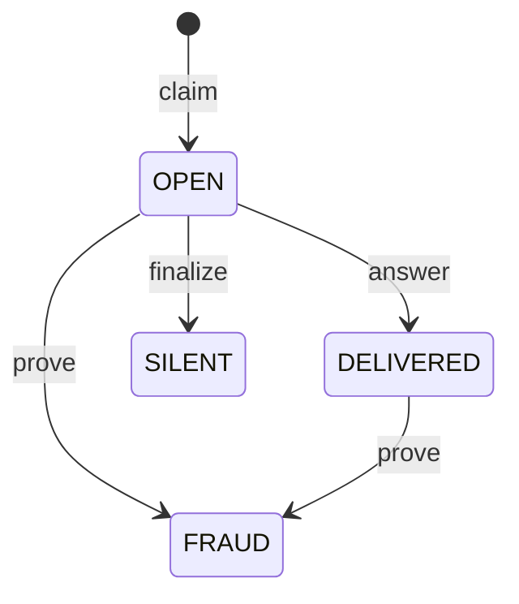

# SealedDelivery

SealedDelivery lets a seller stand behind a paid answer without holding the buyer's money. The payment settles through Circle Gateway and goes to the seller. The contract decides only what happens when the key to a sealed answer does not arrive, or opens something other than what the seller signed.

Live on Arc testnet at [`0xa1eff55da9f1cee94d608e2570bda89f8f2ce5b5`](https://explorer.testnet.arc.io/address/0xa1eff55da9f1cee94d608e2570bda89f8f2ce5b5), deployed by Arc Studio on 2026-11-05 at 22:20 UTC. `contract-metadata/SealedDelivery.json` lists earlier deployments of earlier source, and the demo does not use them.

## Where the idea comes from

FairSwap, by Dziembowski, Eckey and Faust (CCS 2018): https://eprint.iacr.org/2018/740. A seller sends an encrypted file, reveals the key on chain, and the chain looks closer only when somebody complains.

SealedDelivery adapts that to nanopayments settled in Gateway batches. FairSwap holds the payment in the contract, and SealedDelivery holds a seller deposit instead, because the payment has already gone through Gateway. FairSwap proves one wrong step with a Merkle proof, and SealedDelivery decrypts the whole ciphertext on chain, which suits small cached answers.

## How it works

1. Before paying, the buyer reads `coverageFor(seller, value)`. Then it signs a Gateway payment (`TransferWithAuthorization`).
2. The seller verifies the payment, seals the answer with a fresh key for this request, signs a `Promise`, and settles through Gateway. Then it returns the box: ciphertext, promise and seller signature.
3. The buyer asks for the key on a separate request with the same payment, and asks once more if that fails. If the key opens the box and the plaintext matches the signed hash, the job is done and the contract never hears about it.
4. If the key does not come, the buyer sends `claim` with the promise and its own payment signature.
5. The seller, or anyone else holding the key, sends `answer(claimId, key)` before the deadline. The buyer reads the key from the `KeyRevealed` event.
6. If the deadline passes, anyone can send `finalize(claimId)`. If the key opens something other than the signed plaintext, anyone holding the key and ciphertext can send `prove(claimId, ciphertext, key)`.

The sealing is keccak in counter mode: for block `i`, the keystream is `keccak256(abi.encodePacked(key, uint256(i)))`, XORed with each 32 byte chunk. `src/lib/sealed.ts` is the off chain side and `_plaintextHash` is the on chain side.

A claim id is `keccak256(abi.encode(seller, buyer, paymentNonce))`.

## State transitions



`Status` is `NONE`, `OPEN`, `DELIVERED`, `SILENT` or `FRAUD`. SILENT and FRAUD are final. Below, `liability` is `2 * (value + DISPUTE_COST)`, capped at `type(uint128).max`.

| From | Call | Who | Required, or it reverts with | To | Effect |
|---|---|---|---|---|---|
| NONE | `claim(p, sellerSignature, auth, buyerSignature)` | The buyer: `msg.sender == auth.from` (`NotBuyer`) | Seller signature recovers to `p.seller` (`InvalidSellerSignature`). Buyer signature recovers to `auth.from` (`InvalidBuyerSignature`). `p.buyer == auth.from` (`WrongBuyer`). `auth.to == p.seller` (`WrongPayee`). `auth.value == p.value` (`WrongValue`). `auth.nonce == p.paymentNonce` (`WrongNonce`). `now < p.expiry` (`PromiseExpired`). `p.expiry - now <= MAX_EXPIRY` (`ExpiryTooFar`). Claim id unused (`AlreadyClaimed`) | OPEN | No money moves. `openLiability[seller] += liability`. `deadline = now + ANSWER_WINDOW`. Emits `Claimed` |
| OPEN | `answer(claimId, key)` | Anyone | Status is OPEN (`NotOpen`). `now < deadline` (`AnswerWindowClosed`). `keccak256(key) == keyHash` (`WrongKey`) | DELIVERED | `openLiability[seller] -= liability`. `proofHold[seller]` grows by `liability`, after resetting to 0 if the last hold had ended. `proofHoldUntil[seller] = now + COOLDOWN - MAX_EXPIRY`. Emits `KeyRevealed` |
| OPEN | `finalize(claimId)` | Anyone | Status is OPEN (`NotOpen`). `now >= deadline` (`DeadlineNotReached`) | SILENT | `openLiability[seller] -= liability`. `silentCount[seller] += 1`. The deposit pays (below). Emits `Silent` |
| OPEN or DELIVERED | `prove(claimId, ciphertext, key)` | Anyone with the key and ciphertext | Not already FRAUD (`AlreadyFraud`). Status is OPEN or DELIVERED (`NotProvable`). `keccak256(key) == keyHash` (`WrongKey`). `keccak256(ciphertext) == ciphertextHash` (`WrongCiphertext`). Decrypted hash differs from `plaintextHash` (`PromiseKept`). No deadline | FRAUD | From OPEN, `openLiability[seller] -= liability`. `fraudCount[seller] += 1`. The deposit pays (below). `proofHold` stays as it was. Emits `Fraud` |

**When the deposit pays.** `payout = min(liability, deposits[seller])`. The deposit falls by `payout`, and `pendingWithdrawal[seller]` comes down with it if it would exceed the new deposit. The buyer's `claimable` grows by half of `payout`, rounded up. The rest joins `pendingBurn`.

Calls outside a claim:

| Call | Who | Required, or it reverts with | Effect |
|---|---|---|---|
| `deposit(amount)` | The seller | `amount > 0` (`ZeroAmount`), and a USDC approval | `deposits[seller] += amount` |
| `requestWithdraw(amount)` | The seller | `amount > 0` (`ZeroAmount`). `amount <= coverage(seller)` (`ExceedsCoverage`) | `pendingWithdrawal[seller] += amount`. The whole cooldown restarts at `now + COOLDOWN` |
| `withdrawDeposit()` | The seller | Something pending (`NothingPending`). Cooldown over (`CooldownActive`). Something free after open liability and any running proof hold (`LiabilityOpen`) | Sends `min(pending, deposit - held)`. The rest stays queued |
| `withdrawClaimable()` | The buyer | A credit exists (`NothingToWithdraw`) | Sends the buyer's whole credit |
| `flushBurn()` | Anyone | `pendingBurn > 0` (`NothingToWithdraw`) | Sends `pendingBurn` to `0x000000000000000000000000000000000000dEaD` |

Reads: `coverage(seller)` is `deposits - pendingWithdrawal`. `coverageFor(seller, value)` is true when `coverage - openLiability >= 2 * (value + DISPUTE_COST)`.

## The economics

**A verdict repays the dispute.** A claim used about 268,000 gas, which costs more than a sub-cent price. A transaction per payment would not fit these prices, so the contract runs only when a delivery fails. `DISPUTE_COST` is the buyer's gas for going to the chain, fixed at deployment. It came from `claim`, `finalize` and `withdrawClaimable` at 25 gwei on the earlier deployment on 2026-11-05: 420,269 gas, 0.0105 USDC, so it is 10500 here.

On a 0.001 USDC payment, a verdict takes 0.023 USDC from the deposit: 0.0115 to the buyer and 0.0115 burned. On the live contract on 2026-11-05 at 20 gwei, Seller E's `claim` and `finalize` (23:14 to 23:15 UTC) used 367,117 gas. With the 53,249 gas of a `withdrawClaimable`, that is 420,366 gas, 0.0084 USDC. The buyer got back the 0.001 price and all of that gas, and ended 0.0021 USDC ahead. In the filmed run at 25 gwei (22:43 to 22:44 UTC), the same three calls used 437,490 gas, 0.0109 USDC, and the buyer ended 0.0004 USDC short of the price it paid. The deposits went from 0.1 to 0.077 USDC after one verdict and to 0.054 after two.

**Answering is cheaper than silence.** `answer` used 52,811 to 87,400 gas on 2026-11-05, at most 0.0022 USDC at 25 gwei, against 0.023 USDC for silence. Silence costs at least 0.021 USDC at any price, so answering stays cheaper up to about 240 gwei.

**The deposit is one pool per seller, and verdicts draw on it first come, first served.** Nothing is reserved at claim time. Each verdict takes its amount when it lands, and later verdicts get what is left. This keeps capital light: no funds are locked per payment. At a 0.001 USDC price, a 0.1 USDC deposit covers 4 open claims.

**Half burns.** Without the burn, a seller could pay itself the deposit through a second address and lose nothing. With it, a seller that drains itself loses half of what it pulls, rounded down, plus gas. It can still empty the pool ahead of honest buyers, at that price. A blocked burn address cannot stop a verdict, because the burn waits in `pendingBurn` until anyone calls `flushBurn`.

**Withdrawals wait.** `requestWithdraw` removes funds from coverage at once and starts `COOLDOWN`. Queued funds stay in `deposits`, and verdicts can take them until they leave. The constructor requires `cooldown >= maxExpiry + answerWindow`, so a seller that signs a promise and then asks to withdraw stays exposed past that claim's deadline. The proof hold keeps a fraud proof payable after an answer: each answer holds that claim's liability until `COOLDOWN - MAX_EXPIRY` after the seller's latest answer, 3600 s on this deployment.

Measured on the live contract on Arc testnet, 2026-11-05 22:21 to 23:16 UTC. Each fee is at the gas price that transaction paid, 20 to 25 gwei. Each row links one example, and [DEMO.md](../DEMO.md#contract-transactions) lists all 37 transactions.

| Call | Gas | Fee in USDC | Example |
|---|---:|---:|---|
| `deposit` | 76,917 | 0.0019 | [`0xebf7b029…`](https://explorer.testnet.arc.io/tx/0xebf7b0293c574e6bd63bfed5b4ed45ecb51c97962d4d6e968da5ecbd43b6466f) |
| `claim` | 268,376 to 268,460 | 0.0054 to 0.0067 | [`0x24182416…`](https://explorer.testnet.arc.io/tx/0x24182416082b271fe9a2a94897e4151e3a2b80bb0aeda1c991d2a3189c3e3fd6) |
| `answer` | 52,811 to 87,400 | 0.0011 to 0.0022 | [`0x211a089a…`](https://explorer.testnet.arc.io/tx/0x211a089a2bd47d5a549accd135fa84ae36d6e49d20a9dbbb34a9d06cb590ec49) |
| `finalize` | 81,581 to 115,781 | 0.0016 to 0.0029 | [`0xc60c0312…`](https://explorer.testnet.arc.io/tx/0xc60c0312308f03d84561f7f81671947c3095b255f6cc7a60531c178cabe8d127) |
| `prove` on a 70 byte answer | 89,226 to 123,426 | 0.0018 to 0.0031 | [`0xe72c3f4c…`](https://explorer.testnet.arc.io/tx/0xe72c3f4cb07caf1c19757c1b1029749fc89f8c19e31004aa338547b30af3d46b) |
| `flushBurn` | 57,278 | 0.0011 to 0.0014 | [`0xbbcf078a…`](https://explorer.testnet.arc.io/tx/0xbbcf078aa93e38ab4c01f183713c22a2686fc173b363b95d0e855d1ce594add4) |
| `withdrawClaimable` | 53,249 | 0.0013 | [`0xdb2e65cb…`](https://explorer.testnet.arc.io/tx/0xdb2e65cb3ac1bae0ea03982d9ef797a402b77d9d55a05936e91d3a429aa59d77) |

## Limits

- **The deposit is shared, first come, first served.** Nothing is reserved at claim. `coverageFor` counts open claims when read, and it can change after that. A later verdict gets what is left, which can be nothing.
- **A seller with no deposit gets no cover.** A seller that plans to drop answers will not deposit. A claim against an empty deposit still records, and `finalize` still marks SILENT, with nothing paid. vet402 reads coverage first and does not claim when it is short.
- **`DISPUTE_COST` is fixed at deployment.** In the filmed run of 2026-11-05 at 25 gwei, Seller E's dispute (`claim`, `finalize` and `withdrawClaimable`) used 437,490 gas, 0.0109 USDC, which is more than the 0.0105 it covers. `finalize` used 81,581 to 115,781 gas in these runs, so a whole dispute is 403,278 to 437,490 gas, and above about 24 to 26 gwei the verdict no longer covers all of it. Arc mainnet gas is not measured.
- **`DISPUTE_COST` is paid on a verdict only.** A seller that answers on chain owes nothing, so the buyer keeps the claim's gas: 0.0054 USDC at 20 gwei on 2026-11-05 23:11 UTC, for a key it paid 0.001 USDC to receive.
- **A claim needs no proof of non-delivery.** A buyer that already has the key can still claim. The seller then has to answer, or pay. A seller whose watcher is down for the 60 s window pays that buyer's verdict too. Set a longer `answerWindow` for real use.
- **It never sees the payment.** `claim` checks signed intent, and settlement stays in Gateway. A seller must sign a promise only in a flow that settles before the box leaves, as `server/sellers.ts` does.
- **A seller can commit to garbage from the start.** If `plaintextHash` is the hash of junk and the key opens that junk, the promise was kept and `prove` reverts. Judging the content belongs to a delivery check outside this contract.
- **A box lost before it arrives leaves nothing to claim.** Without a signed promise there is no claim. vet402 covers that case with a second fetch on the same payment, for sellers that declare it.
- **A late fraud proof pays from what is left.** `prove` has no deadline, and the proof hold ends. After a completed withdrawal, the proof still marks FRAUD and pays what remains.
- **Disputes publish the answer.** `answer` puts the key on chain, so anyone holding that ciphertext can read the answer. `prove` puts key and ciphertext on chain, so anyone can read it. Keys are per request, so other answers stay sealed.
- **`prove` gas grows with the answer**, because it decrypts in a loop. It suits small answers.
- **Signatures must come from EOAs.** Contract wallets are refused.
- **Arc testnet only, with no outside audit.** Deposits are testnet money. The tests in `contracts/test` passed on 2026-11-05 at 23:20 UTC (219 tests in 16 suites on commit `2d6d920`).

## Use it with your own x402 seller

You can deploy your own copy or deposit into the one above, since each seller has its own pool. The steps below hold for any seller. The code after them uses this repository's helpers on an Express route.

1. **Deposit.** Approve the contract for USDC, then call `deposit(amount)`. USDC here is the 6 decimal ERC-20, and the contract has no native token entry. Size the deposit as `2 * (price + DISPUTE_COST)` times the open claims you want to back. The address that deposits must be the address that signs promises and receives the payment.

2. **Seal in your paid handler.** After you verify the payment and before you settle: make a fresh 32 byte key for this request, encrypt the answer with `sealResponse` from `src/lib/sealed.ts`, and sign a `Promise` bound to this buyer and payment nonce. Set `expiry` at most `MAX_EXPIRY` ahead. This repository uses 3000 s. If settlement fails, return the 402 and throw the box away.

   The EIP-712 domain is `{ name: 'SealedDelivery', version: '1', chainId, verifyingContract }`, and the type string is in `PROMISE_TYPEHASH`.

3. **Serve the key separately.** Add a key route, and hand over the key only to the exact payment header that settled. Store the key and answer on disk, so a restart can still answer a claim.

4. **Run a watcher.** Read `Claimed` events for your seller and call `answer(claimId, key)` before the deadline. Keep gas for it: an answer used 52,811 to 87,400 gas on 2026-11-05 between 22:35 and 23:16 UTC.

5. **Tell the buyer's side.** Before paying, read `coverageFor`. After paying, check the seller's signature, the buyer, nonce, value, ciphertext hash and expiry. Ask for the key, open the box, and compare the hash. If the key does not come, send `claim` from the address that signed the payment, then read `KeyRevealed` until the deadline. `checkBox` and `createSealedPorts` in `server/sealedDelivery.ts` do this.

In TypeScript, with this repository's helpers:

```ts
import { createSealedDelivery, createSealer, createSellerWatcher } from './server/sealedDelivery'
import { createSeller } from './server/sellers'

const client = createSealedDelivery({ address: CONTRACT })

const seller = createSeller({
  name: 'My API',
  payTo: myAddress,
  declaresRecovery: false,
  facilitator,
  confirmCharged: () => Promise.resolve(false),
  dropAfterSettle: () => false,
  storeFile: 'data/my-seller.json',
  sealing: { seal: createSealer(client, sellerKey), handsOverKey: () => true },
})

app.get('/paid', seller)
app.get('/paid/key', seller.key)

createSellerWatcher({ client, sellerKey, keyFor: seller.keyFor, mode: 'answer' }).start()
```

The price (`DEMO_PRICE`) and the answer (`answer`) are set inside `server/sellers.ts`. Copy that file to set your own. In `server/index.ts`, a small wrapper turns a thrown error into a 502. `ARC_NET` points the client at Arc testnet, and the `net` option takes another chain.

## Constructor

| # | Argument | Type | Value on the live deployment | Meaning |
|---:|---|---|---|---|
| 1 | `maxExpiry` | `uint256` | 3600 | The furthest ahead, in seconds, that a promise can expire at claim time. Must be above 0 |
| 2 | `answerWindow` | `uint256` | 60 | Seconds the seller has to answer after a claim. Must be above 0 |
| 3 | `cooldown` | `uint256` | 7200 | Seconds a withdrawal waits. Must be at least `maxExpiry + answerWindow` |
| 4 | `usdc` | `address` | `0x3600000000000000000000000000000000000000` | The deposit token |
| 5 | `paymentDomainName` | `string` | `GatewayWalletBatched` | EIP-712 name of the buyer's payment signature |
| 6 | `paymentDomainVersion` | `string` | `1` | Its version |
| 7 | `paymentVerifyingContract` | `address` | `0x0077777d7EBA4688BDeF3E311b846F25870A19B9` | The Gateway Wallet |
| 8 | `disputeCost` | `uint256` | 10500 | The buyer's cost of going to the chain, in USDC units. Set it from the gas of your chain |
| 9 | `paymentDomainSalt` | `bytes32` | `0x0000000000000000000000000000000000000000000000000000000000000000` | Zero for an unsalted payment domain: Gateway at version `1`, or a token's own EIP-3009 domain as plain x402 signs it. Gateway's batched domain at version `2` is salted with the USDC address, so pass that address padded to 32 bytes |

The chain id in the payment domain is the deployment's own, so deploy on the chain the buyer pays on. The contract has no owner, administrator or upgrade path, and these values are immutable.

```bash
forge create contracts/SealedDelivery.sol:SealedDelivery \
  --rpc-url https://rpc.testnet.arc.network \
  --private-key "$DEPLOYER_KEY" \
  --broadcast \
  --constructor-args 3600 60 7200 0x3600000000000000000000000000000000000000 GatewayWalletBatched 1 0x0077777d7EBA4688BDeF3E311b846F25870A19B9 10500 \
    0x0000000000000000000000000000000000000000000000000000000000000000
```

This repository's deployment went through Arc Studio. I checked the command above, with the same arguments, on a local anvil chain on 2026-11-05 at 23:29 UTC.

## Tests

```bash
forge install foundry-rs/forge-std --no-git
forge test
```

`lib/` is git-ignored, so the first line is needed on a fresh clone.
