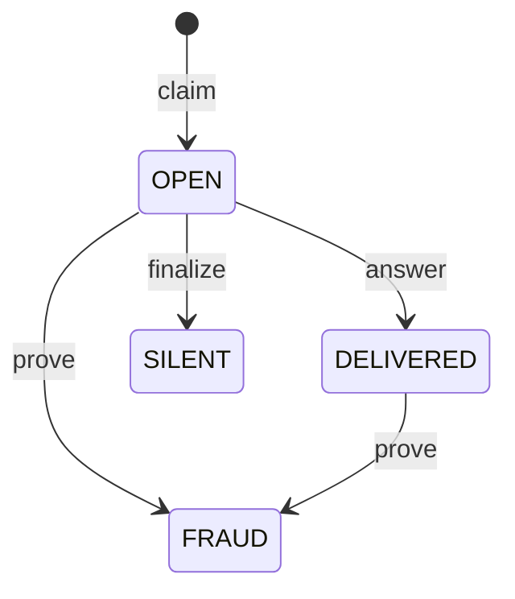

# SealedDelivery

SealedDelivery lets a seller stand behind a paid answer without holding the buyer's money. The payment settles through Circle Gateway and goes to the seller. The contract decides only what happens when the key to a sealed answer does not arrive, or opens something other than what the seller signed.

This source is the one deployed. It repays the buyer's gas at the price the claim actually paid.

| Network | Address | Deployed (UTC) | Source check |
|---|---|---|---|
| Arc testnet, 5042002 | [`0xE9C35ad2caF5D76CA5a5F61ca2256995197C2A4B`](https://explorer.testnet.arc.io/address/0xE9C35ad2caF5D76CA5a5F61ca2256995197C2A4B) | 2026-11-06 01:35:22, [`0x38095fb7…`](https://explorer.testnet.arc.io/tx/0x38095fb7894b86e2c57be1d1bb6e367ddbc6fd9fc9276ecacc43ac37701b3733), `forge create` from the terminal of the Arc Studio sandbox | Verified on the Arc testnet explorer (Blockscout) at 01:50 UTC. The verified file has the same sha256 as this one (`93a08889…`) |
| Arc mainnet, 5042 | [`0xf3e2a77e1a93eeb791ae1016f411e5bb8a05e6d9`](https://explorer.arc.io/address/0xf3e2a77e1a93eeb791ae1016f411e5bb8a05e6d9) | 2026-11-06 02:02:56, [`0x6a276f7a…`](https://explorer.arc.io/tx/0x6a276f7a2ca79260ccdfc28a809b889a2febd95d684e9a5db818ecb2581eabd8), by script | Sourcify `exact_match`, with the same sha256 |

Both take the recommended arguments under [Constructor](#constructor). Mainnet takes Arc mainnet's Gateway Wallet, `0x77777777Dcc4d5A8B6E418Fd04D8997ef11000eE`. Before the testnet deploy, the source was pasted into the code editor of the Studio sandbox and the tests copied in through its terminal, where forge 1.7.1 passed 246 tests and failed 0. That count includes `contracts/test-integration`, which only the sandbox holds.

Earlier versions charged a fixed dispute cost in place of the gas each claim paid: `0xa1eff55da9f1cee94d608e2570bda89f8f2ce5b5` on testnet (deployed by Arc Studio on 2026-11-05 at 22:20 UTC, `disputeCost` 0.0105 USDC) and `0xafdb8931eebdce7f714ac3905c65a50293eb6db6` on mainnet (2026-11-05 21:59 UTC, 0.009 USDC). `contract-metadata/SealedDelivery.json` lists deployments of earlier source.

## Where the idea comes from

FairSwap, by Dziembowski, Eckey and Faust (CCS 2018): https://eprint.iacr.org/2018/740. A seller sends an encrypted file, reveals the key on chain, and the chain looks closer only when somebody complains.

SealedDelivery adapts that to nanopayments settled in Gateway batches. FairSwap holds the payment in the contract, and SealedDelivery holds a seller deposit instead, because the payment has already gone through Gateway. FairSwap proves one wrong step with a Merkle proof, and SealedDelivery decrypts the whole ciphertext on chain, which suits small cached answers.

## How it works

1. Before paying, the buyer reads `coverageFor(seller, value)`. Then it signs a Gateway payment (`TransferWithAuthorization`).
2. The seller verifies the payment, seals the answer with a fresh key for this request, signs a `Promise`, and settles through Gateway. Then it returns the box: ciphertext, promise and seller signature.
3. The buyer asks for the key on a separate request with the same payment, and asks once more if that fails. If the key opens the box and the plaintext matches the signed hash, the job is done and the contract never hears about it.
4. If the key does not come, the buyer sends `claim` with the promise and its own payment signature. The claim measures its own gas, so whichever way the dispute ends, the buyer gets that gas back from the seller's deposit.
5. The seller, or anyone else holding the key, sends `answer(claimId, key)` before the deadline. The buyer reads the key from the `KeyRevealed` event, and the same transaction sends it the claim's gas.
6. If the deadline passes, anyone can send `finalize(claimId)`. If the key opens something other than the signed plaintext, anyone holding the key and ciphertext can send `prove(claimId, ciphertext, key)`.

The sealing is keccak in counter mode: for block `i`, the keystream is `keccak256(abi.encodePacked(key, uint256(i)))`, XORed with each 32 byte chunk. `src/lib/sealed.ts` is the off chain side and `_plaintextHash` is the on chain side.

A claim id is `keccak256(abi.encode(seller, buyer, paymentNonce))`.

## State transitions



`Status` is `NONE`, `OPEN`, `DELIVERED`, `SILENT` or `FRAUD`. SILENT and FRAUD are final. Below, `price` is `min(tx.gasprice, MAX_GAS_PRICE)` at the claim, `claimGas` is the claim's own gas (measured by `claim`, plus `CLAIM_TX_OVERHEAD`, at most `CLAIM_GAS_CAP`), and every gas amount becomes USDC units at `WEI_PER_USDC_UNIT` (1e12), rounded up.

- `gasRefund = claimGas * price`, what an answer repays the buyer.
- `disputeCost = (claimGas + FOLLOW_UP_GAS) * price`, the buyer's gas for the whole dispute.
- `liability = 2 * (value + disputeCost)`, capped at `type(uint128).max`.

| From | Call | Who | Required, or it reverts with | To | Effect |
|---|---|---|---|---|---|
| NONE | `claim(p, sellerSignature, auth, buyerSignature)` | The buyer: `msg.sender == auth.from` (`NotBuyer`) | Seller signature recovers to `p.seller` (`InvalidSellerSignature`). Buyer signature recovers to `auth.from` (`InvalidBuyerSignature`). `p.buyer == auth.from` (`WrongBuyer`). `auth.to == p.seller` (`WrongPayee`). `auth.value == p.value` (`WrongValue`). `auth.nonce == p.paymentNonce` (`WrongNonce`). `now > auth.validAfter` (`PaymentNotYetValid`). `auth.validBefore > auth.validAfter + 1` (`PaymentNeverValid`). `now < p.expiry` (`PromiseExpired`). `p.expiry - now <= MAX_EXPIRY` (`ExpiryTooFar`). Claim id unused (`AlreadyClaimed`) | OPEN | No money moves. Stores `gasRefund` and `liability`. `openLiability[seller] += liability`. `deadline = now + ANSWER_WINDOW`. Emits `Claimed` |
| OPEN | `answer(claimId, key)` | Anyone | Status is OPEN (`NotOpen`). `now < deadline` (`AnswerWindowClosed`). `keccak256(key) == keyHash` (`WrongKey`) | DELIVERED | `openLiability[seller] -= liability`. `proofHold[seller]` grows by `liability`, after resetting to 0 if the last hold had ended. `proofHoldUntil[seller] = now + COOLDOWN - MAX_EXPIRY`. The deposit repays the buyer (below). Emits `KeyRevealed`, then `ClaimGasRepaid` |
| OPEN | `finalize(claimId)` | Anyone | Status is OPEN (`NotOpen`). `now >= deadline` (`DeadlineNotReached`) | SILENT | `openLiability[seller] -= liability`. `silentCount[seller] += 1`. The deposit pays (below). Emits `Silent` |
| OPEN or DELIVERED | `prove(claimId, ciphertext, key)` | Anyone with the key and ciphertext | Not already FRAUD (`AlreadyFraud`). Status is OPEN or DELIVERED (`NotProvable`). `keccak256(key) == keyHash` (`WrongKey`). `keccak256(ciphertext) == ciphertextHash` (`WrongCiphertext`). Decrypted hash differs from `plaintextHash` (`PromiseKept`). No deadline | FRAUD | From OPEN, `openLiability[seller] -= liability`. `fraudCount[seller] += 1`. The deposit pays (below). `proofHold` stays as it was. Emits `Fraud` |

**When the deposit pays a verdict.** `payout = min(liability, deposits[seller])`. The deposit falls by `payout`, and `pendingWithdrawal[seller]` comes down with it if it would exceed the new deposit. The buyer's `claimable` grows by half of `payout`, rounded up, which is `value + disputeCost` when the deposit holds enough. The rest joins `pendingBurn`.

**When an answer repays the claim.** `refund = min(gasRefund, deposits[seller])` leaves the deposit the same way and goes straight to the buyer in the same transaction. If the token refuses the transfer, it is credited to `claimable` instead, and `ClaimGasRepaid` says `sent = false`. An answer never fails over it.

**Why `validAfter` and not `validBefore`.** EIP-3009 settles a payment only while `validAfter < now < validBefore`. Before `validAfter`, the payment cannot have settled yet, so a claim then is refused. A window with no whole second inside it can never settle, so it is refused too. `validBefore` is not compared with the claim's time: the payment settled before it, and the claim comes after the settlement, often after `validBefore` has passed. Gateway signs `validAfter` about 600 s back and `validBefore` about a week ahead.

Calls outside a claim:

| Call | Who | Required, or it reverts with | Effect |
|---|---|---|---|
| `deposit(amount)` | The seller | `amount > 0` (`ZeroAmount`), and a USDC approval | `deposits[seller] += amount` |
| `requestWithdraw(amount)` | The seller | `amount > 0` (`ZeroAmount`). `amount <= coverage(seller)` (`ExceedsCoverage`) | `pendingWithdrawal[seller] += amount`. The whole cooldown restarts at `now + COOLDOWN` |
| `withdrawDeposit()` | The seller | Something pending (`NothingPending`). Cooldown over (`CooldownActive`). Something free after open liability and any running proof hold (`LiabilityOpen`) | Sends `min(pending, deposit - held)`. The rest stays queued |
| `withdrawClaimable()` | The buyer | A credit exists (`NothingToWithdraw`) | Sends the buyer's whole credit |
| `flushBurn()` | Anyone | `pendingBurn > 0` (`NothingToWithdraw`) | Sends `pendingBurn` to `0x000000000000000000000000000000000000dEaD` |

Reads: `coverage(seller)` is `deposits - pendingWithdrawal`. `coverageFor(seller, value)` is true when `coverage - openLiability >= 2 * (value + MAX_DISPUTE_COST)`, the most a claim over `value` can cost at any gas price up to `MAX_GAS_PRICE`. `gasRefundOf(claimId)` is what an answer repays. `claims(claimId)` returns the same nine fields as before.

## The economics

**A dispute leaves the buyer at or above zero, whatever the seller does, under three conditions.** The claim's gas price is at or below `MAX_GAS_PRICE` (100 gwei in both deployments). The buyer sends its later calls (`finalize`, `prove`, `withdrawClaimable`) at the claim's gas price or lower. And the seller's free deposit still covers the verdict when it lands (`coverageFor` was true before paying, and no earlier verdict drained the pool). Outside any of them the buyer carries the difference, as [Limits](#limits) says case by case. A claim used about 271,000 gas, which costs more than a sub-cent price. So the contract counts the buyer's gas, at the gas price the claim actually paid, and makes the seller carry it.

- **Silent or lying seller.** The verdict credits the buyer `value + disputeCost`: the price, the claim's measured gas, and `FOLLOW_UP_GAS` for the verdict and the withdrawal. The seller pays the same again into the burn.
- **Seller answers on chain.** The answer sends the buyer `gasRefund`, the claim's gas, in the same transaction. The buyer already has the key it paid for, so this is all it is owed. It needs no second transaction, whose gas would not be repaid.

I checked this in `test_Economics_BuyerNeverLosesAndNeverGainsFromAnAnswer`, with the buyer starting with no USDC so that its withdrawal costs the most, every call at the claim's gas price, and a deposit that covers the verdict. Buyer net is what came back, less the price (except after an answer, when the key came), less its own gas, in USDC:

| Gas price | SILENT | FRAUD (claim, prove) | Answered |
|---:|---:|---:|---:|
| 1 gwei | +0.000050 | +0.000058 | +0.000007 |
| 25 gwei | +0.002103 | +0.001884 | +0.000166 |
| 100 gwei | +0.008412 | +0.007533 | +0.000665 |
| 1000 gwei, test deployment only | +0.084102 | +0.075348 | +0.006631 |

The test deploys with `maxGasPrice` at 1000 gwei, its own ceiling, so the last row is the test's and not the live contract's. The deployed contracts cap at 100 gwei: a claim sent above that is repaid as if at 100 gwei, and the buyer carries the rest.

`scripts/sealed-local-e2e.ts` checks the same from real receipts on anvil: the buyer ends at or above zero after silence and fraud, and between zero and 5 % of its claim gas after an answer.

**An answer is no profit for the buyer.** The claim measures its own gas from its first line, after booking its largest liability, so the first writes of every slot are inside the measurement. `CLAIM_TX_OVERHEAD` (42,000) covers the rest: the 21,000 base, the calldata, the dispatch and the event. That rest was about 35,100 gas on anvil, so an answered buyer ends about 2.5 % of its claim gas ahead: the 6,900 gas of margin that covers calldata with fewer zero bytes. A claim made while the seller already has one open costs less (254,225 gas), and the refund follows it.

**Gas above the cap is the buyer's.** Costs are counted at `min(tx.gasprice, MAX_GAS_PRICE)`, so a buyer that pays more than the cap carries the difference. The cap also bounds what one claim can cost a seller.

**Answering is cheaper than silence.** At the same gas price, an answer costs the seller its own gas (at most 132,231 on anvil) and the buyer's claim gas, about 410,000 gas. Silence costs twice `value + disputeCost`, more than 1,015,000 gas. Answering stays cheaper while the seller's gas price is under about 5 times the claim's.

**The deposit is one pool per seller, and verdicts draw on it first come, first served.** Nothing is reserved at claim time. Each verdict takes its amount when it lands, and later verdicts get what is left. This keeps capital light: no funds are locked per payment. With `MAX_GAS_PRICE` at 100 gwei, `coverageFor` asks 0.112 USDC per open claim at a 0.001 USDC price, so a 0.5 USDC deposit covers 4. At 25 gwei a claim actually books about 0.0274.

**Half burns.** Without the burn, a seller could pay itself the deposit through a second address and lose nothing. With it, a seller that drains itself loses half of what it pulls, rounded down, plus gas. It can still empty the pool ahead of honest buyers, at that price. A blocked burn address cannot stop a verdict, because the burn waits in `pendingBurn` until anyone calls `flushBurn`.

**Withdrawals wait.** `requestWithdraw` removes funds from coverage at once and starts `COOLDOWN`. Queued funds stay in `deposits`, and verdicts can take them until they leave. The constructor requires `cooldown >= maxExpiry + answerWindow`, so a seller that signs a promise and then asks to withdraw stays exposed past that claim's deadline. The proof hold keeps a fraud proof payable after an answer: each answer holds that claim's liability until `COOLDOWN - MAX_EXPIRY` after the seller's latest answer, 3600 s with the recommended values.

Measured on 2026-11-06. The ranges are anvil receipts of this source, from `scripts/sealed-local-e2e.ts` and calibration runs. The numbers in brackets and the 1 KiB proof are from `forge test`. Gas does not depend on the gas price.

| Call | Gas | Fee at 25 gwei in USDC |
|---|---:|---:|
| `claim` | 271,013 to 271,049 (254,225 when the seller already has an open claim) | 0.0068 |
| `answer`, with the refund transfer | 98,019 to 132,231 | 0.0025 to 0.0033 |
| `finalize` | 115,862 to 115,874 (86,474 when the counters are already set) | 0.0022 to 0.0029 |
| `prove` on a 70 to 100 byte answer | 107,552 to 123,440 | 0.0027 to 0.0031 |
| `prove` on a 1 KiB answer | at most 148,451 | 0.0037 |
| `withdrawClaimable` | 41,343 to 58,443 (the higher when the buyer held no USDC) | 0.0010 to 0.0015 |

On Arc, 2026-11-06, the deployed contract matched these ranges. Read with `cast receipt`, all status 1:

| Call | Arc testnet, 01:37 to 02:05 UTC | Arc mainnet, 02:03 to 02:04 UTC |
|---|---|---|
| `claim` | 271,013 to 271,049 | 271,037 and 271,049 |
| `answer`, with the refund transfer | 131,592 to 131,604 for a seller's first answer, 97,015 after | 131,604 |
| `answer` with a wrong key, reverted on purpose | 29,267 and 29,279 | |
| `finalize` | 115,862 the first time for a seller, 98,774 after | 115,874 |
| `prove` on a 70 byte answer | 123,452 the first time, 106,352 after | |
| `withdrawClaimable` | 53,316 | 53,316 |
| `flushBurn` | 57,256 | 57,256 |

What the buyer got back, from the events of those transactions. An answer's `ClaimGasRepaid` came out above the claim's fee every time, by about 2.6 %: claim [`0x6fbe43cb…`](https://explorer.testnet.arc.io/tx/0x6fbe43cb52a151c51b4b01736bcc99f94bc9f98b249c42de09acf54c1af0d5da) cost 0.006775 USDC (271,013 gas at 25 gwei) and its answer [`0x7e816df8…`](https://explorer.testnet.arc.io/tx/0x7e816df8f4631d9b0172c9a3da16f820f56dc4360f0657816d9914bc29f3fc11) repaid 0.006949. On mainnet, claim [`0x183be3f0…`](https://explorer.arc.io/tx/0x183be3f0fb87c826b6f26f2a4103e5419772843d842c3718f96e284c85e37fa8) cost 0.005421 and its answer [`0x7541a28b…`](https://explorer.arc.io/tx/0x7541a28bc973fec1969705db7a5e407e48b8ec27c8ff9419732ceb03fd235124) repaid 0.00556, so the buyer ended 0.000139 USDC ahead. A silent seller on mainnet ([`0x52162804…`](https://explorer.arc.io/tx/0x521628040a75d008ab4fed04c01f7351ea2035d4c6ed93e5b3fe581b99865555)) credited the buyer 0.01116 USDC, which left it 0.001355 ahead after the price, its claim, the `finalize` and the withdrawal. The testnet verdicts of 2026-11-06 are in [DEMO.md](../DEMO.md#contract-transactions).

The earlier testnet contract used 268,376 to 268,460 gas per `claim` on 2026-11-05, close to the 271,000 here, which also checks the `validAfter` window and books the gas.

## Limits

- **The deposit is shared, first come, first served.** Nothing is reserved at claim. `coverageFor` counts open claims when read, and it can change after that. A later verdict gets what is left, which can be nothing.
- **A seller with no deposit gets no cover.** A seller that plans to drop answers will not deposit. A claim against an empty deposit still records, and `finalize` still marks SILENT, with nothing paid, and an answer repays nothing. vet402 reads coverage first and does not claim when it is short.
- **Gas is repaid only up to `MAX_GAS_PRICE`.** A buyer that claims above it carries the part above. The verdict's share is counted at the claim's price too, so a buyer that sends `finalize`, `prove` or `withdrawClaimable` at a higher price than its claim carries that difference.
- **`FOLLOW_UP_GAS` is sized for small answers.** 230,000 covers the worst `finalize` or a `prove` on up to 1 KiB, plus a withdrawal. A proof on a larger answer costs the buyer more than it gets back for that step.
- **A claim needs no proof of non-delivery.** A buyer that already has the key can still claim, and now does it at no cost to itself, since an answer repays its gas. The seller pays its answer and that claim gas, about 0.010 USDC at 25 gwei, and each such claim needs a payment the seller already settled. A seller whose watcher is down for the 60 s window pays that buyer's verdict too. Set a longer `answerWindow` for real use.
- **The seller's guard against that buyer reads the chain, not the contract.** `buyerClaimRecord` in `packages/sealed-delivery` counts a buyer's `Claimed` events and how many of its latest claims ended in a `KeyRevealed`, that is, the seller had the key and handed it over. The middleware's `claimGuard` option then refuses that buyer a sealed box, without charging it, or asks it a higher price that the seller sets, for example the 0.010 USDC such a claim costs it. The contract itself still accepts every valid claim. The record follows one address: a buyer that moves to a fresh one starts clean, though every claim from it still needs a payment the seller settled. And a buyer whose line really did drop several times looks the same, so the bar (3 answered among the latest 5 by default) is the seller's choice.
- **A blocked buyer waits for its refund.** If the token refuses the answer's transfer, the refund becomes a credit, and the buyer pays the gas of `withdrawClaimable` itself.
- **Gas is converted as USDC.** `WEI_PER_USDC_UNIT` is 1e12 because Arc charges gas in USDC at 18 decimals and the deposit token has 6. I checked that on 2026-11-06 at 02:26 UTC: the native balance of `0xE9C35ad2…` was exactly 1e12 times its ERC-20 balance of 2.247216 USDC. On a chain whose gas is another token, deploy with `maxGasPrice` 0, which repays no gas.
- **It never sees the payment.** `claim` checks signed intent and the authorization's `validAfter` window, and settlement stays in Gateway. A seller must sign a promise only in a flow that settles before the box leaves, as `server/sellers.ts` does.
- **A seller can commit to garbage from the start.** If `plaintextHash` is the hash of junk and the key opens that junk, the promise was kept and `prove` reverts. Judging the content belongs to a delivery check outside this contract.
- **A box lost before it arrives leaves nothing to claim.** Without a signed promise there is no claim. vet402 covers that case with a second fetch on the same payment, for sellers that declare it.
- **A late fraud proof pays from what is left.** `prove` has no deadline, and the proof hold ends. After a completed withdrawal, the proof still marks FRAUD and pays what remains. A seller that answered and is then proven to have lied has already repaid the claim gas, and the verdict pays the whole dispute cost again.
- **Disputes publish the answer.** `answer` puts the key on chain, so anyone holding that ciphertext can read the answer. `prove` puts key and ciphertext on chain, so anyone can read it. Keys are per request, so other answers stay sealed.
- **`prove` gas grows with the answer**, because it decrypts in a loop. It suits small answers.
- **Signatures must come from EOAs.** Contract wallets are refused.
- **Testnet and a small mainnet run only, with no outside audit.** The tests in `contracts/test` passed on 2026-11-06 between 02:10 and 02:20 UTC on a fresh clone of `main` at `4ad89eb` (236 tests in 19 suites, forge 1.8.3).

## Use it with your own x402 seller

You can deploy your own copy, or deposit into a shared one, since each seller has its own pool. The steps below hold for any seller. The code after them uses this repository's helpers on an Express route.

1. **Deposit.** Approve the contract for USDC, then call `deposit(amount)`. USDC here is the 6 decimal ERC-20, and the contract has no native token entry. Size the deposit as `2 * (price + MAX_DISPUTE_COST)` times the open claims you want to back, since that is what `coverageFor` asks for. Each claim you answer on chain also repays its gas from the deposit. The address that deposits must be the address that signs promises and receives the payment.

2. **Seal in your paid handler.** After you verify the payment and before you settle: make a fresh 32 byte key for this request, encrypt the answer with `sealResponse` from `src/lib/sealed.ts`, and sign a `Promise` bound to this buyer and payment nonce. Set `expiry` at most `MAX_EXPIRY` ahead. This repository uses 3000 s. If settlement fails, return the 402 and throw the box away.

   The EIP-712 domain is `{ name: 'SealedDelivery', version: '1', chainId, verifyingContract }`, and the type string is in `PROMISE_TYPEHASH`.

3. **Serve the key separately.** Add a key route, and hand over the key only to the exact payment header that settled. Store the key and answer on disk, so a restart can still answer a claim.

4. **Run a watcher.** Read `Claimed` events for your seller and call `answer(claimId, key)` before the deadline. Keep gas for it: an answer, with its refund transfer, used 98,019 to 132,231 gas on anvil on 2026-11-06. Handing the key over its own route is cheaper still, since then nobody claims.

5. **Tell the buyer's side.** Before paying, read `coverageFor`. After paying, check the seller's signature, the buyer, nonce, value, ciphertext hash and expiry. Ask for the key, open the box, and compare the hash. If the key does not come, send `claim` from the address that signed the payment, then read `KeyRevealed` until the deadline. `checkBox` and `createSealedPorts` in `server/sealedDelivery.ts` do this.

In TypeScript, with this repository's helpers:

```ts
import { createSealedDelivery, createSealer, createSellerWatcher } from './server/sealedDelivery'
import { createSeller } from './server/sellers'

const client = createSealedDelivery({ address: CONTRACT })

const seller = createSeller({
  name: 'My API',
  payTo: myAddress,
  declaresRecovery: false,
  facilitator,
  confirmCharged: () => Promise.resolve(false),
  dropAfterSettle: () => false,
  storeFile: 'data/my-seller.json',
  sealing: { seal: createSealer(client, sellerKey), handsOverKey: () => true },
})

app.get('/paid', seller)
app.get('/paid/key', seller.key)

createSellerWatcher({ client, sellerKey, keyFor: seller.keyFor, mode: 'answer' }).start()
```

The price (`DEMO_PRICE`) and the answer (`answer`) are set inside `server/sellers.ts`. Copy that file to set your own. In `server/index.ts`, a small wrapper turns a thrown error into a 502. `ARC_NET` points the client at Arc testnet, and the `net` option takes another chain.

## Constructor

| # | Argument | Type | Recommended on Arc testnet | Meaning |
|---:|---|---|---|---|
| 1 | `maxExpiry` | `uint256` | 3600 | The furthest ahead, in seconds, that a promise can expire at claim time. Must be above 0 |
| 2 | `answerWindow` | `uint256` | 60 | Seconds the seller has to answer after a claim. Must be above 0 |
| 3 | `cooldown` | `uint256` | 7200 | Seconds a withdrawal waits. Must be at least `maxExpiry + answerWindow` |
| 4 | `usdc` | `address` | `0x3600000000000000000000000000000000000000` | The deposit token |
| 5 | `paymentDomainName` | `string` | `GatewayWalletBatched` | EIP-712 name of the buyer's payment signature |
| 6 | `paymentDomainVersion` | `string` | `1` | Its version |
| 7 | `paymentVerifyingContract` | `address` | `0x0077777d7EBA4688BDeF3E311b846F25870A19B9` | The Gateway Wallet |
| 8 | `followUpGas` | `uint256` | 230000 | Gas the buyer spends after a claim: the worst `finalize` or a `prove` on up to 1 KiB (148,451), plus `withdrawClaimable` (58,443), each a whole transaction, with room to spare. At most `type(uint64).max` |
| 9 | `maxGasPrice` | `uint256` | 100000000000 (100 gwei) | The highest gas price, in wei, a claim's costs are counted at. Arc testnet charged 20 to 25 gwei on 2026-11-05 and 2026-11-06, so 100 gwei leaves 4 times headroom while `coverageFor` asks only 0.112 USDC per claim at a 0.001 USDC price. 1000 gwei would ask 1.1 USDC per claim. 0 repays no gas |
| 10 | `paymentDomainSalt` | `bytes32` | `0x0000000000000000000000000000000000000000000000000000000000000000` | Zero for an unsalted payment domain: Gateway at version `1`, or a token's own EIP-3009 domain as plain x402 signs it. Gateway's batched domain at version `2` is salted with the USDC address, so pass that address padded to 32 bytes |

`MAX_DISPUTE_COST` follows from them: `(CLAIM_GAS_CAP + followUpGas) * maxGasPrice`, in USDC units, 55,000 (0.055 USDC) with the values above. The constructor reverts with `InvalidDisputeCost` if `followUpGas` or `maxGasPrice` is out of range. The chain id in the payment domain is the deployment's own, so deploy on the chain the buyer pays on. The contract has no owner, administrator or upgrade path, and these values are immutable.

```bash
forge create contracts/SealedDelivery.sol:SealedDelivery \
  --rpc-url https://rpc.testnet.arc.network \
  --private-key "$DEPLOYER_KEY" \
  --broadcast \
  --constructor-args 3600 60 7200 0x3600000000000000000000000000000000000000 GatewayWalletBatched 1 0x0077777d7EBA4688BDeF3E311b846F25870A19B9 230000 100000000000 \
    0x0000000000000000000000000000000000000000000000000000000000000000
```

After deploying, each seller deposits at least 0.5 USDC (`scripts/sealed-setup.ts` tops the demo sellers up to that), so that `coverageFor` stays true for a 0.001 USDC price with room for several claims.

## Tests

```bash
forge install foundry-rs/forge-std --no-git
forge test
```

`lib/` is git-ignored, so the first line is needed on a fresh clone.
