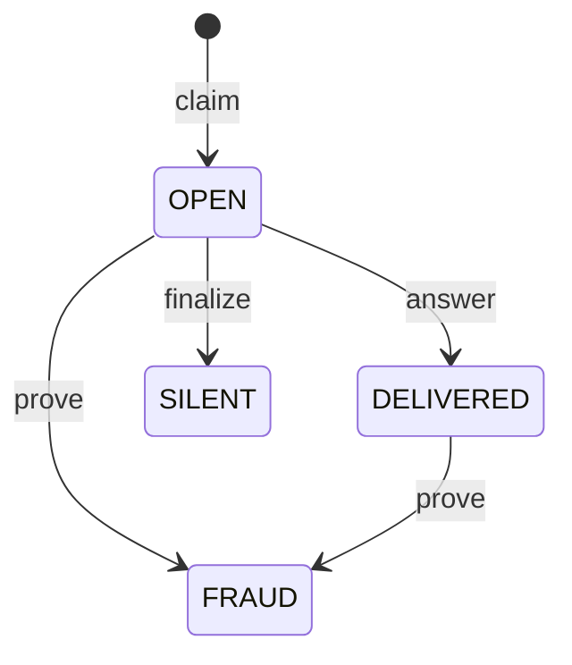

# SealedDelivery

SealedDelivery lets a seller stand behind a paid answer without holding the buyer's money. The payment settles through Circle Gateway. The contract decides only what happens when the key to a sealed answer does not arrive, or opens something other than what the seller signed.

Live on Arc testnet at [`0x2dab71e2e13d8f6acef80b8964776b2bc24f69d2`](https://explorer.testnet.arc.io/address/0x2dab71e2e13d8f6acef80b8964776b2bc24f69d2). `contract-metadata/SealedDelivery.json` lists two earlier deployments of earlier source, and the demo does not use them.

## Where the idea comes from

FairSwap, by Dziembowski, Eckey and Faust: https://eprint.iacr.org/2018/740. A seller sends an encrypted file, reveals the key on chain, and the chain looks closer only when somebody complains.

SealedDelivery adapts that to nanopayments settled in Gateway batches. FairSwap holds the payment in the contract, and SealedDelivery holds a seller deposit instead, because the payment has already gone through Gateway. FairSwap proves one wrong step with a Merkle proof, and SealedDelivery decrypts the whole ciphertext on chain, which suits small cached answers.

## How it works

1. The buyer signs a Gateway payment (`TransferWithAuthorization`). Before paying, it reads `coverageFor(seller, value)`.
2. The seller verifies the payment, seals the answer with a fresh key for this request, signs a `Promise`, and settles through Gateway. Then it returns the box: ciphertext, promise and seller signature.
3. The buyer asks for the key on a separate request with the same payment. If the key opens the box and the plaintext matches the signed hash, the job is done and the contract never hears about it.
4. If the key does not come, the buyer sends `claim` with the promise and its own payment signature.
5. The seller, or anyone else holding the key, sends `answer(claimId, key)` before the deadline. The buyer reads the key from the `KeyRevealed` event.
6. If the deadline passes, anyone can send `finalize(claimId)`. If the key opens something other than the signed plaintext, anyone holding the key and ciphertext can send `prove(claimId, ciphertext, key)`.

`claim` moves no money. It checks both signatures and that the buyer, payee, value and nonce line up: `msg.sender` and `p.buyer` equal `auth.from`, `auth.to` equals `p.seller`, and value and nonce match. A claim id is `keccak256(abi.encode(seller, buyer, paymentNonce))`, so each one is single use and a stranger cannot take the buyer's place.

The sealing is keccak in counter mode: for block `i`, the keystream is `keccak256(abi.encodePacked(key, uint256(i)))`, XORed with each 32 byte chunk. `src/lib/sealed.ts` is the off chain side and `_plaintextHash` is the on chain side.

## States



| From | Call | Who | When | To | Effect |
|---|---|---|---|---|---|
| NONE | `claim` | The buyer named in the promise | Before the promise expires, and the expiry is at most `MAX_EXPIRY` ahead | OPEN | `openLiability` grows by 2x the value. The deadline is now plus `ANSWER_WINDOW` |
| OPEN | `answer` | Anyone | Before the deadline, with `keccak256(key) == keyHash`. A wrong key reverts | DELIVERED | Liability released. 2x the value stays held in `proofHold` |
| OPEN | `finalize` | Anyone | At or after the deadline | SILENT | The deposit pays |
| OPEN or DELIVERED | `prove` | Anyone with the key and ciphertext | No deadline. Key and ciphertext must match their hashes and the plaintext must differ from the signed hash | FRAUD | The deposit pays |

SILENT and FRAUD are final. `prove` reverts with `PromiseKept` when the promise was kept, so a false accusation costs the caller gas alone.

## The economics

**The deposit is one pool per seller, and verdicts draw on it first come, first served.** Nothing is reserved at claim time. Each verdict takes `min(2 * value, deposit)` when it lands, and later verdicts get what is left. This keeps capital light: a deposit of 0.01 USDC backs 5 open claims at a price of 0.001 USDC, with no funds locked per payment. A buyer reads `coverageFor(seller, value)` before paying. It returns true when the deposit, minus queued withdrawals and open liability, is at least twice the value.

**Silence costs twice the price, and half of that burns.** The buyer gets half rounded up as a pull credit (`withdrawClaimable`). The rest queues in `pendingBurn` until anyone calls `flushBurn`, which sends it to `0x000000000000000000000000000000000000dEaD`. A blocked burn address cannot stop a verdict. On 2026-11-05, Seller E's deposit went from 0.01 to 0.008 USDC for a 0.001 USDC payment.

**A seller that drains itself through a second address loses half.** Filing against its own promises pulls deposit into a credit it controls, and half of each pull burns. It can still empty the pool ahead of honest buyers, at a price of half the pool.

**Withdrawals wait.** `requestWithdraw` removes funds from coverage at once and starts `COOLDOWN`. Queued funds stay in `deposits`, and verdicts can take them until they leave. `withdrawDeposit` holds back open liability and the proof hold. The constructor requires `cooldown >= maxExpiry + answerWindow`, so a seller that signs a promise and then asks to withdraw stays exposed past that claim's deadline. After each answer, 2x that claim's value waits `COOLDOWN - MAX_EXPIRY`, which is 3600 s on this deployment, so a fraud proof has something to pay from.

Measured on Arc testnet, 2026-11-05 UTC, at the 25 gwei those transactions paid:

| Call | Gas | Fee in USDC |
|---|---:|---:|
| `claim` | 268,317 | 0.0067 |
| `answer` | 87,355 | 0.0022 |
| `finalize` | 98,681 | 0.0025 |
| `prove` on a 70 byte answer | 123,414 | 0.0031 |
| `withdrawClaimable` | 53,271 | 0.0013 |

## Limits

The contract cannot close these.

- **It never sees the payment.** `claim` checks signed intent, and settlement stays in Gateway. A seller must sign a promise only in a flow that settles before the box leaves, as `server/sellers.ts` does.
- **A seller can commit to garbage from the start.** If `plaintextHash` is the hash of junk and the key opens that junk, the promise was kept and `prove` reverts. Judging the content belongs to a delivery check outside this contract.
- **No deposit means no money back.** A claim against an empty deposit still records and `finalize` still marks SILENT, with nothing paid. A positive `coverageFor` can also go stale between the read and the verdict, because the pool is shared.
- **A box lost before it arrives leaves nothing to claim.** Without a signed promise there is no claim. vet402 covers that case with a second fetch on the same payment, for sellers that declare it.
- **A late fraud proof pays from what is left.** `prove` has no deadline, and the proof hold ends. After a completed withdrawal, the proof still marks FRAUD and pays what remains.
- **Disputes publish the answer.** `answer` puts the key on chain, so anyone holding that ciphertext can read the answer. `prove` puts key and ciphertext on chain, so anyone can read it. Keys are per request, so other answers stay sealed.

These follow from the numbers above and hold for this deployment:

- **Below about 0.0105 USDC, a claim for money does not pay for itself.** At 25 gwei, `claim`, `finalize` and `withdrawClaimable` cost the buyer 0.0105 USDC together, and the credit equals the value. At the demo price of 0.001 USDC, the buyer spends more gas than it recovers, and the demo files claims to show the path working. Gas prices move, so this line moves with them.
- **Below about 0.0011 USDC, silence costs the seller less than answering.** `answer` costs 0.0022 USDC at 25 gwei, and silence costs 2x the value. A seller that only counts this one claim would stay silent at 0.001 USDC. `silentCount` is public, so silence also leaves a record.
- **`prove` gas grows with the answer**, because it decrypts in a loop. It suits small answers.
- **The answer window is 60 s here**, which suits a demo. A seller whose watcher is down that long pays. Set a longer `answerWindow` for real use.
- **Signatures must come from EOAs.** Contract wallets are refused.
- **Arc testnet only, with no outside audit.** The tests in `contracts/test` passed on 2026-11-05 (214 tests on commit `0676762`).

## Use it with your own x402 seller

You can deploy your own copy or deposit into the one above, since each seller has its own pool. The steps below hold for any seller. The code after them uses this repository's helpers on an Express route.

1. **Deposit.** Approve the contract for USDC, then call `deposit(amount)`. USDC here is the 6 decimal ERC-20, and the contract has no native token entry. Size the deposit as twice your price times the open claims you want to back. The address that deposits must be the address that signs promises and receives the payment.

2. **Seal in your paid handler.** After you verify the payment and before you settle: make a fresh 32 byte key for this request, encrypt the answer with `sealResponse` from `src/lib/sealed.ts`, and sign a `Promise` bound to this buyer and payment nonce. Set `expiry` at most `MAX_EXPIRY` ahead. This repository uses 3000 s. If settlement fails, return the 402 and throw the box away.

   The EIP-712 domain is `{ name: 'SealedDelivery', version: '1', chainId, verifyingContract }`, and the type string is in `PROMISE_TYPEHASH`.

3. **Serve the key separately.** Add a key route, and hand over the key only to the exact payment header that settled. Store the key and answer on disk, so a restart can still answer a claim.

4. **Run a watcher.** Read `Claimed` events for your seller and call `answer(claimId, key)` before the deadline. Keep gas for it, 87,355 gas per answer on 2026-11-05.

5. **Tell the buyer's side.** Before paying, read `coverageFor`. After paying, check the seller's signature, the buyer, nonce, value, ciphertext hash and expiry. Ask for the key, open the box, and compare the hash. If the key does not come, send `claim` from the address that signed the payment, then read `KeyRevealed` until the deadline. `checkBox` and `createSealedPorts` in `server/sealedDelivery.ts` do all of this.

In TypeScript, with this repository's helpers:

```ts
import { createSealedDelivery, createSealer, createSellerWatcher } from './server/sealedDelivery'
import { createSeller } from './server/sellers'

const client = createSealedDelivery({ address: CONTRACT })

const seller = createSeller({
  name: 'My API',
  payTo: myAddress,
  declaresRecovery: false,
  facilitator,
  confirmCharged: () => Promise.resolve(false),
  dropAfterSettle: () => false,
  storeFile: 'data/my-seller.json',
  sealing: { seal: createSealer(client, sellerKey), handsOverKey: () => true },
})

app.get('/paid', seller)
app.get('/paid/key', seller.key)

createSellerWatcher({ client, sellerKey, keyFor: seller.keyFor, mode: 'answer' }).start()
```

The price (`DEMO_PRICE`) and the answer (`answer`) are set inside `server/sellers.ts`. Copy that file to set your own. In `server/index.ts`, a small wrapper turns a thrown error into a 502. `ARC_NET` points the client at Arc testnet, and the `net` option takes another chain.

## Constructor

| # | Argument | Type | Value on the live deployment | Meaning |
|---:|---|---|---|---|
| 1 | `maxExpiry` | `uint256` | 3600 | The furthest ahead, in seconds, that a promise can expire at claim time. Must be above 0 |
| 2 | `answerWindow` | `uint256` | 60 | Seconds the seller has to answer after a claim. Must be above 0 |
| 3 | `cooldown` | `uint256` | 7200 | Seconds a withdrawal waits. Must be at least `maxExpiry + answerWindow` |
| 4 | `usdc` | `address` | `0x3600000000000000000000000000000000000000` | The deposit token |
| 5 | `paymentDomainName` | `string` | `GatewayWalletBatched` | EIP-712 name of the buyer's payment signature |
| 6 | `paymentDomainVersion` | `string` | `1` | Its version. `2` uses Gateway's salted form |
| 7 | `paymentVerifyingContract` | `address` | `0x0077777d7EBA4688BDeF3E311b846F25870A19B9` | The Gateway Wallet |

The chain id in the payment domain is the deployment's own, so deploy on the chain the buyer pays on. The contract has no owner, administrator or upgrade path, and these values are immutable.

```bash
forge create contracts/SealedDelivery.sol:SealedDelivery \
  --rpc-url https://rpc.testnet.arc.network \
  --private-key "$DEPLOYER_KEY" \
  --broadcast \
  --constructor-args 3600 60 7200 0x3600000000000000000000000000000000000000 GatewayWalletBatched 1 0x0077777d7EBA4688BDeF3E311b846F25870A19B9
```

This repository's deployment went through Arc Studio. I checked the command above on a local anvil chain on 2026-11-05.

## Tests

```bash
forge install foundry-rs/forge-std --no-git
forge test
```

`lib/` is git-ignored, so the first line is needed on a fresh clone.
